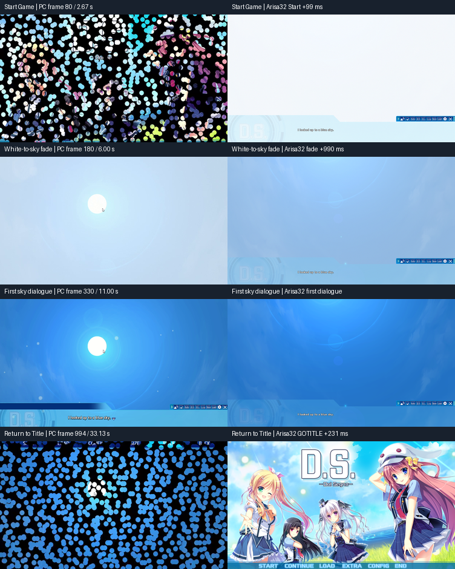

# Efek pembuka dan kembali ke judul Dal Segno

Perbandingan sebelum perbaikan pada 26 November 2026 memakai rekaman Dal Segno PC berdurasi 34,77 detik
(1.043 frame, 30 fps), aset MangaGamer yang terpasang, dan renderer desktop
Arisa32 dengan aset yang sama. Nomor frame dimulai dari nol.

| Efek | Rekaman PC | Arisa32 |
| --- | --- | --- |
| Lingkaran saat **Start Game** | Frame 77–89 (02,57–02,97). Potongan bulat membawa warna layar judul dan menyusut sampai layar hitam pada frame 90. | Tidak muncul. Klik Start langsung mencapai fade prolog dengan kotak dialog sudah terlihat. |
| Cahaya pembuka | Layar hitam pada frame 108 (03,60), putih pada frame 133 (04,43), lalu gambar langit muncul perlahan hingga sekitar frame 292 (09,73). Dialog mulai di frame 293. | Fade putih ke langit berjalan sekitar 2 detik dengan konfigurasi desktop yang diuji. Ramp hitam ke putih dan urutan tampilnya dialog belum cocok. Matahari terpotong di tepi atas pada capture Arisa32. |
| Partikel kecil bercahaya | Tampak bergerak mulai sekitar 10,33 detik. Bentuk dan luminansinya cocok dengan atlas `SYSTEM/EFFYOUSEI.CRX`, yang juga dipakai untuk fairy lights di D.C.4 dan Plus Harmony. | Tidak muncul. Area langit yang diuji tetap identik antar-frame dengan jeda 500 ms dan setelah pengaturan efek dimatikan. |
| Lingkaran saat **Return to Title** | Muncul di frame 992 (33,07) dan hampir seluruhnya gelap pada frame 1000 (33,33). Judul terlihat lagi pada frame 1004 (33,47). | Tidak muncul saat menjalankan `GOTITLE.mes` langsung di renderer desktop. Jalur konfirmasi Android memuat `main.mes` langsung untuk profil Dal Segno. |

## Skrip dan pengaturan

- `main.mes` memakai `0x0E(16,4)` pada offset 4915 untuk Start Game.
  `GOTITLE.mes` memakai perintah yang sama pada offset 42. Saat perbandingan
  awal direkam, dispatcher belum menjalankan mode 16 untuk Dal Segno.
- `DS_1129B_CM.mes` memuat `BG062B` dan menjalankan `0x93` pada offset 417 dan
  426, `0x27(15,5)` pada 435, fade `0x0E(0,5)` pada 438, dan `0x27(13,1)`
  pada 441. Hanya perintah fade yang dipetakan untuk efek tersebut dalam profil
  Dal Segno. Halo dan cincin besar di sekitar matahari juga terlihat di aset
  `BG062B.CRX` tanpa animasi. Partikel kecil yang ditunjuk panah terlihat
  berpindah di atas latar tersebut.
- `CONFIG.mes` punya aksi `eff_on`, `eff_skipon`, dan `eff_off` yang menulis
  `99[10]` menjadi 1, 2, dan 0. Pengujian renderer memakai mode 1 dan 0 serta
  sakelar `visual_effects_enabled` secara terpisah. Kontrol **Visual effect**
  di pengaturan library Android tersedia untuk profil D.C.4 dan Plus Harmony.

## Verifikasi transisi mode 16

Renderer desktop memakai aset `SYSTEM/EFFBREAK.CRX` untuk mengecilkan potongan
layar yang sedang tampil. Pada kedua transisi, bagian layar atas yang berubah
menjadi hitam naik dari sekitar 7% pada frame awal menjadi 55–56% pada 99 ms
dan 91–92% pada 231 ms. Warnanya tetap sama dengan layar asal di dalam
potongan yang tersisa. Durasi mode 16 ditetapkan 400 ms.

Start Game mencapai dialog pertama prolog. Return to Title menjalankan
`GOTITLE.mes` lalu kembali ke `MAIN.mes` dengan piksel yang sama seperti judul
awal. Tombol Start dapat dipakai lagi sesudah efek berakhir. Probe desktop juga
memeriksa bahwa input tombol judul diabaikan saat efek berjalan dan skrip
melanjutkan eksekusi ketika efek dilewati atau pengaturan efek visual dimatikan.

Desktop CTest menghasilkan 42 lulus, satu dilewati (`dc2ty_voice_test`), dan tiga
kegagalan yang juga muncul sebelum perubahan (`mesopcode_test`, `audio_test`,
dan `dalsegno_motion_test`). APK debug arm64 berhasil dibangun.

Probe JNI `menus` di I2219 menangkap efek Start Game dan mencapai layar nama.
Setelah konfirmasi Return to Title, probe menangkap efek dari slot 03, 05, dan
06. Ketiga hasil akhir identik piksel demi piksel dengan layar judul awal.
Load dari judul juga membuka layar slot, lalu Back mengembalikan judul yang sama.
Probe memakai aset hanya-baca dan salinan save yang terisolasi. Perbandingan
menggunakan frame berurutan karena adegan dapat terus bergerak selama skrip
menyiapkan transisi.

Probe regresi `toolbar`, `name`, `name-restart`, dan `transitions` juga lulus
di I2219. APK debug arm64 dipasang sebagai pembaruan. SHA-256 APK yang terpasang
cocok dengan APK yang diuji
(`9cb303912de8003717b2c01fe7232ac088837c7d081a0980943d4941bb51aa04`).
