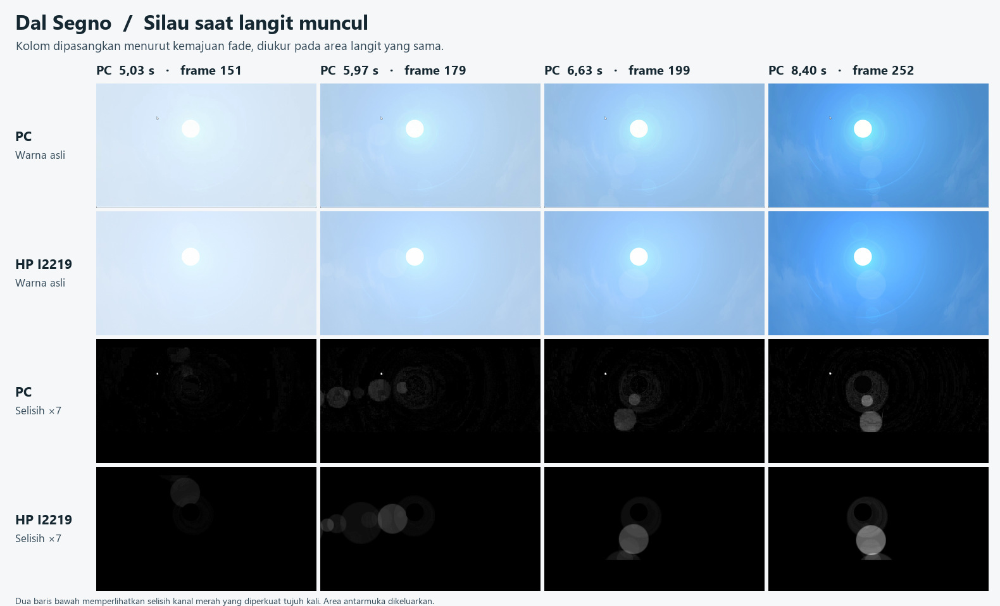

# Sapuan silau pada pembuka Dal Segno

Rekaman PC `20261127-0003-28.8958375.mp4` berisi 319 frame pada 30 fps. Nomor frame dimulai dari nol. Setelah bilah judul 24 piksel dipotong, area permainan berukuran 1280 × 720. Pusat matahari dan cincin besar pada `BG062B.CRX` tetap di tempat. Bercak pantulan di depan langit bergerak mengitari titik (550, 264).

| Frame PC | Waktu | Yang terlihat |
| --- | --- | --- |
| 90–93 | 3,00–3,10 s | Layar hitam setelah transisi dari judul. |
| 94–126 | 3,13–4,20 s | Layar berangsur putih dan mencapai putih pada frame 120. |
| 127 | 4,23 s | Warna langit mulai terukur. Kontras masih terlalu rendah untuk mengukur arah pantulan dengan andal. |
| 150 | 5,00 s | Pantulan melewati sisi kiri atas matahari pada sekitar 200°. |
| 180 | 6,00 s | Pantulan melintas ke kiri, sedikit di bawah matahari, pada sekitar 282°. |
| 200 | 6,67 s | Pantulan mencapai kiri bawah pada sekitar 334°. |
| 213–281 | 7,10–9,37 s | Arah bertahan di sekitar 369° ketika langit terus bertambah jelas. |
| 282 | 9,40 s | Pantulan hilang dan antarmuka dialog muncul. |

Sudut mengikuti koordinat gim. 0° mengarah ke bawah, 90° ke kanan. Pengukuran mempertahankan putaran melewati 360°. Berkas CSV memuat waktu dan fase untuk setiap frame. Kolom sudut dikosongkan sebelum frame 146 dan sesudah frame 281. [Data 319 frame](dalsegno-opening-frames.csv)

## Perintah yang sebelumnya terlewat

Pada v0.7.5, renderer sudah menjalankan fade dan menampilkan halo bawaan gambar latar. Dua perintah di `DS_1129B_CM.mes` belum menghasilkan pantulan bergerak.

- `0x93` pada offset 417 menetapkan pusat (550, 264). Pada offset 426, perintah yang sama memilih sapuan dari 120° ke 370° dalam 180 tick pada 60 Hz, atau 3 detik.
- `0x27(15,5)` pada offset 435 membuat 20 pantulan dari atlas `SYSTEM/EFFLENS.CRX`. Renderer mengambil ukuran, jarak dan opasitas tiap bercak sekali, lalu memutar susunannya selama fade `0x0E(0,5)`. Pada kecepatan efek bawaan, fade berlangsung 5,4 detik.
- `0x27(13,1)` pada offset 441 mengganti pantulan dengan partikel `SYSTEM/EFFYOUSEI.CRX` sebelum dialog pertama, “I looked up to a blue sky.”

## Perbandingan dengan HP I2219

Probe Android menjalankan JNI dari APK debug pada I2219 dengan aset asli dan profil uji terpisah. Setelah menekan Start Game, probe membiarkan pembuka berjalan sampai dialog pertama. Pada enam tingkat kecerahan langit, probe mengambil sepasang bitmap dengan waktu animasi yang sama dan mematikan pantulan pada bitmap pembanding. Pada rekaman PC, latar pembanding dihitung dari frame putih 124 dan langit terbuka pada frame 286. Porsi fade diukur di langit kanan atas. Arah diperkirakan dari kelebihan intensitas kanal merah sepanjang garis radial.

| Frame PC | Porsi langit pada HP | Arah terukur PC | Arah terukur HP |
| --- | ---: | ---: | ---: |
| 151 | 19% | 201° | 201,5° |
| 179 | 35% | 275° | 277° |
| 199 | 50% | 334° | 340,5° |
| 217 | 61% | 369° | 370,5° |
| 252 | 83% | 369° | 370,5° |

Pada sampel 83%, bercak paling terang di area ukur menaikkan kanal merah sekitar 21 tingkat pada HP dan 16 pada rekaman PC (skala 0–255, rata-rata jendela 15 × 15 piksel). Ukuran dan opasitas bercak diacak oleh gim. Angka ini mengukur piksel keluaran renderer. Kecerahan fisik panel HP tidak diukur.

Seluruh 46 tes CTest lulus. Tes gerak Dal Segno juga memeriksa gambar saat efek dimatikan, arah awal dan tengah, posisi akhir yang bertahan, serta hilangnya pantulan saat mode 13 mengambil alih. Probe Android `opening` dan `menus` lulus di I2219. SHA-256 APK debug yang diuji adalah `71dc2f396d8df8ce64f328b03e8fd1cbeab37648484702368b722a15a2106a85`.
