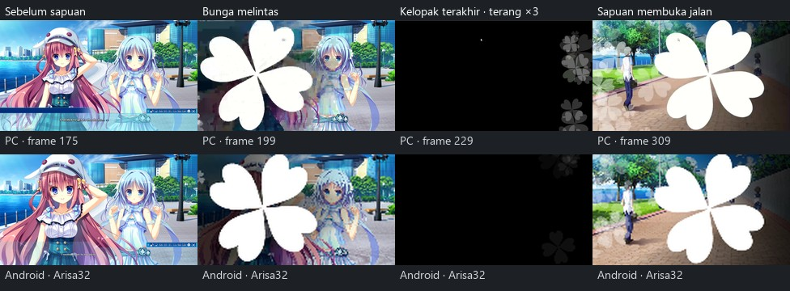

# Sapuan hitam dan kelopak putih Dal Segno

Pada rekaman PC `20261127-0137-32.4208702.mp4`, pemain meninggalkan pantai setelah kalimat “I needed to get to the dorms...” di akhir `DS_1129B_CM`. Pergantian ke hitam memakai `37(6,0)` pada offset 36398 dan `0E(21,6)` pada 36401. Di awal `DS_1129C_CM`, perintah yang sama pada 488 dan 491 membuka jalan menuju asrama (`BG/BG014NM`). Dialog berikutnya berbunyi “...Almost there.”

## Rekaman PC

Seluruh 498 frame didekode berurutan pada 30 fps. Nomor frame dimulai dari nol. Untuk pengukuran warna, area permainan diambil dari 718 baris terbawah, dipangkas tiga piksel di setiap sisi dan diukur pada 320 × 180. CSV mencatat perubahan warna dari frame sebelumnya, proporsi putih, hitam dan abu-abu, serta posisi horizontal pusat wilayah putih terbesar. Teks, pointer dan artefak kompresi dapat memengaruhi fraksi kecil. [Data tiap frame](dalsegno-petal-frames.csv) · [Cuplikan berurutan](dalsegno-petal-frames.jpg)

| Frame | Waktu video | Peristiwa teramati |
| --- | --- | --- |
| 180–185 | 6,00–6,17 dtk | Jendela dialog pantai menghilang. |
| 186–220 | 6,20–7,33 dtk | Bunga putih besar berputar searah jarum jam dari kiri ke kanan. Pada frame 203 pusatnya melewati tengah layar. Sapuan menggelapkan latar di belakangnya. |
| 221–231 | 7,37–7,70 dtk | Bunga besar meninggalkan tepi kanan. Kelopak kecil masih bergerak di atas hitam. Pada frame 225 sekitar 15% area ukur masih abu-abu. |
| 232–284 | 7,73–9,47 dtk | Bidang permainan tampak hitam. Mulai frame 237 semua sampel memenuhi ambang hitam. |
| 285–325 | 9,50–10,83 dtk | Tepi jalan mulai muncul. Bunga besar terlihat jelas di kiri pada frame 292, melintasi tengah pada 307 dan keluar di kanan. |
| 326–336 | 10,87–11,20 dtk | Sisa kelopak memudar di atas jalan. |

Siluet putih besar dicocokkan dengan atlas asli pada 66 frame selama kedua lintasan. Irisan dibagi gabungan area putih (IoU) median 0,925 untuk putaran searah jarum jam dan 0,573 untuk arah sebaliknya. Regresi posisi pada frame 190–219 dan 294–322 menghasilkan perkiraan durasi lintasan penuh 1,28 detik pada kedua bagian rekaman. Beberapa frame video mengulang pose yang sama.

## Gerak dan waktu di mesin

Profil Dal Segno membaca `37(durasi, pola)`. Aset `SYSTEM/EFFCHANGESCREEN` di slot 17 menyediakan bunga besar dan kecil. Mask slot 16 menentukan arah sapuan. Arisa32 menggambar kelopak di atas sapuan, menggerakkan keduanya menurut waktu yang berlalu dan membiarkan ekor kelopak selesai selama jeda skrip.

| Pola normal | Mask | Gerak bunga besar | Kelopak kecil | Durasi sapuan | Durasi bunga besar | Kelopak terakhir |
| --- | --- | --- | --- | ---: | ---: | ---: |
| 0 | MASK13A | 1 dari kiri | 33 dari kiri | 1,2 dtk | 1,2 dtk | hingga 1,6 dtk |
| 1 | MASK10A | 2 dari arah berlawanan | 17 dari kiri, 15 dari kanan | 1,2 dtk | 2,0 dtk | hingga 2,4 dtk |

Handler asli memakai 12 tick pada 60 Hz per satuan durasi, putaran 540°, skala kelopak kecil 20–99% dan opasitas awal 50–90% yang turun hingga nol. Kelopak kecil mendapat tambahan acak 0, 0,2 atau 0,4 detik. Pengaturan cepat bawaan skenario memilih argumen durasi 2. Saat dimainkan normal, penggeser kecepatan efek tidak memendekkan gerak ini. Jeda `13(5,0)` dan penantian sisa efek `13(254,0)` tetap mengikuti skrip.

## Lokasi di data MangaGamer

Pemindaian 310 berkas MES menemukan 667 pemuatan slot 17 untuk atlas ini. Setiap pemuatan melayani tiga cabang pengaturan yang saling eksklusif. Seluruh 2.001 perintah `37` diikuti sapuan mode 21. Pada cabang normal ada 492 lokasi pola 0 dan 175 lokasi pola 1. Di akhir `DS_1129C_CM` sendiri, offset 33383 memilih dua bunga besar untuk pergantian berikutnya. [Indeks lokasi dan kondisi tiap cabang](dalsegno-petal-locations.csv)

| Rute | Berkas MES | Lokasi |
| --- | ---: | ---: |
| AM | 33 | 132 |
| CM | 58 | 112 |
| HD | 43 | 129 |
| HM | 53 | 98 |
| IO | 38 | 85 |
| ME | 1 | 4 |
| NE | 36 | 107 |
| Total | 262 | 667 |

Seluruh pemicu ada di berkas skenario `ds_*.mes`. Skrip judul, pengaturan, simpan/muat dan galeri juga diperiksa. Enam rutin galeri CG memakai `MASK11A` tanpa perintah kelopak. Kolom `target_bg_linear` mengambil latar dari urutan kode. Pilihan pemain dan cabang skrip menentukan urutan adegan saat dimainkan.

## Biaya gambar

Atlas asli berukuran 1024 × 720 dan semua piksel yang terlihat berwarna putih. Setelah dekode, mesin menyimpan kanal opasitas pada 499 × 360 dan memakai ulang satu bidang opasitas 641 × 361. Kedua larik memakai 411.041 byte (401,4 KiB) di luar daftar sprite, buffer layar, mask dan memori sementara dekode. Posisi, rotasi dan jumlah partikel tetap mengikuti skrip. Latar dan hasil akhir tetap 1280 × 720.

Mesin menggabungkan kelopak pada bidang 640 × 360, lalu menghaluskan tepinya saat menggambar ke layar. Baris dan kolom ekstra menyimpan nilai piksel tepi. Android memakai instruksi ARM NEON untuk mencampur sapuan dan kelopak. Bidang transparan dilewati, dan latar statis dapat dipakai lagi selama efek berjalan.

Saat latar pantai dimuat ulang setelah close-up, mesin mengembalikan posisi dasar tokoh sehingga Himari tetap di kiri dan Ame di kanan sampai sapuan menutupi mereka. Di Android, penghitung waktu untuk jeda animasi Dal Segno dimulai setelah pemuatan adegan selesai. Ini menjaga bagian awal lintasan ketika membaca aset dari penyimpanan lambat.

## Pengujian Android

Probe memuat pustaka JNI dari APK di I2219 (Snapdragon 6 Gen 1, SM6450) dan membatasi proses pada empat inti hemat daya CPU 0–3. Probe satu bunga memuat salinan save PC, memainkan bagian pantai sampai dialog terakhir, lalu mengikuti skrip melewati hitam hingga dialog pertama di jalan. Probe dua bunga memulai salinan checkpoint di bagian jalan dan mengikuti pergantian berikutnya. Waktu yang diukur mencakup panggilan render JNI pada bitmap 1280 × 720. Pengukuran tidak mencakup waktu presentasi panel.

Pada ARM64, kelopak kecil terakhir masih terlihat 1,58 detik sesudah frame awal pola satu bunga dan 2,35 detik sesudah frame awal pola dua bunga. Frame awal masing-masing memuat 3,2% dan 0% piksel putih. Pengukuran memakai ambang putih RGB ≥ 247 di semua kanal. Dalam perbandingan di bawah, kolom kelopak terakhir diterangkan tiga kali pada kedua gambar supaya kelopak yang hampir transparan terbaca. Cuplikan bergerak Android disampel pada 160 × 90.

| Arsitektur APK | Pola | Frame aktif terukur | Median render | Persentil ke-95 |
| --- | --- | ---: | ---: | ---: |
| ARM64 | Satu bunga, keluar dan masuk | 57 | 24,90 ms | 38,12 ms |
| ARM64 | Dua bunga, keluar | 54 | 23,89 ms | 33,03 ms |
| ARM 32-bit | Satu bunga, keluar dan masuk | 52 | 26,69 ms | 38,01 ms |
| ARM 32-bit | Dua bunga, keluar | 49 | 27,51 ms | 37,64 ms |

Probe memilih frame aktif berdasarkan luas bunga putih atau kelopak kelabu yang terukur. Tiap kombinasi pola dan arsitektur diuji satu kali pada APK akhir. Sebagian frame melampaui anggaran 33,3 ms untuk 30 fps. Helio P35, Helio G81 dan Snapdragon 439 dengan RAM 3 GB belum diuji langsung.

Seluruh 46 tes desktop lulus. Pada APK yang sama, uji regresi Android juga lulus untuk sapuan bandara ke pantai dan pantulan lensa di pembukaan. APK debug memuat ARM64 dan ARM 32-bit, dengan SHA-256 `d6a175f94d3ebbbedd4b5bd03d38aca4da965781ecc1e19e1223b300ae0b7c3a`.
