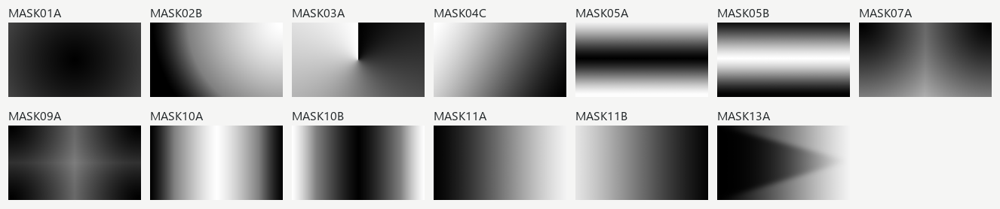
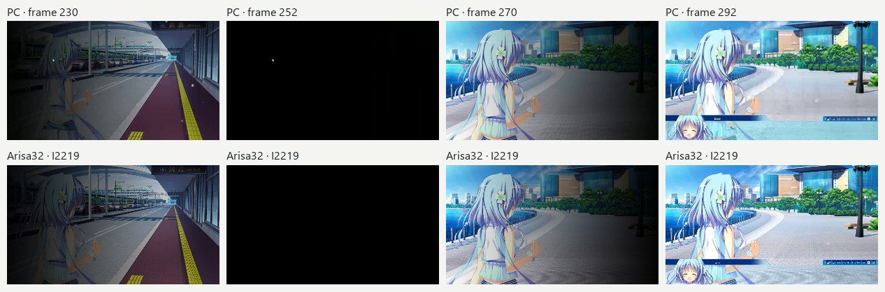

# Transisi layar Dal Segno

Sapuan dari kiri ke kanan pada rekaman bandara menggunakan `MSK/MASK11A`. Pemindaian seluruh 310 berkas MES edisi MangaGamer menemukan pola ini pada 324 perintah cerita dan enam rutin galeri. Semua pemuatan aset `MASK11A` dalam perintah `3A` memakai slot 16. Untuk mencari adegan, pilih rute di bawah atau filter kolom `mask` pada indeks. [Indeks semua perintah](dalsegno-wipe-locations.csv)

## Lokasi di skenario

| Rute (akhiran MES) | Skrip dengan MASK11A | Perintah MASK11A | Perintah semua pola mode 21 |
| --- | ---: | ---: | ---: |
| AM | 21 | 87 | 541 |
| CM | 18 | 34 | 441 |
| HD | 24 | 106 | 633 |
| HM | 12 | 25 | 384 |
| IO | 12 | 24 | 325 |
| ME | 0 | 0 | 12 |
| NE | 15 | 48 | 501 |
| Galeri CG | 6 | 6 | 6 |

Dalam rekaman, transisi keluar dan masuk memakai dua perintah terpisah. Di bagian lain, satu pemuatan mask bisa melayani beberapa cabang pengaturan. Ada 667 kelompok berisi tiga pilihan yang saling eksklusif, masing-masing dengan parameter 2, 2, dan 6. Kolom `lexical_condition` mencatat kondisi yang melingkupi perintah. Durasi di CSV adalah durasi skrip jika efek berjalan. Saat efek dimatikan, renderer langsung menampilkan tujuan.

Daftar berikut berisi setiap perintah cerita yang memakai pola rekaman. Angka setelah nama berkas adalah **offset byte desimal** di dalam skrip. CSV juga memuat indeks teks terakhir dalam label, offset pemuatan mask, serta argumen latar yang ditemukan sebelum dan sesudah tangkapan menurut urutan kode. Latar aktual bisa dipengaruhi cabang dan sprite saat dimainkan.

AM — 87 perintah dalam 21 skrip

- `ds_1218c_am.mes` · 29714, 29861, 30099, 30243, 30477, 30589, 30700, 30809, 30911, 31020, 31119, 31228
- `ds_1221c_am.mes` · 21078, 21193
- `ds_1222c_am.mes` · 6013, 6122
- `ds_1224c_am.mes` · 2399, 2468, 3165, 3225, 11136, 11285
- `ds_1225a_am.mes` · 2900, 2958, 5225, 5337, 6769, 6920
- `ds_1225b_am.mes` · 5896, 6040, 7591, 7737
- `ds_1226b_am.mes` · 2909, 2969, 9592, 9741
- `ds_1303c_am.mes` · 6994, 7062, 9083, 9195
- `ds_1307d_am.mes` · 19285, 19404
- `ds_1310b_am.mes` · 5379, 5526, 18576, 18639, 18853, 18914
- `ds_1313c_am.mes` · 17217, 17327
- `ds_1316a_am.mes` · 3143, 3259
- `ds_1317b_am.mes` · 3382
- `ds_1318c_am.mes` · 7907, 8053, 11029, 11173
- `ds_1319c_am.mes` · 8822, 8934
- `ds_1322c_am.mes` · 3777, 3837
- `ds_1323d_am.mes` · 5675, 5822
- `ds_1325a_am.mes` · 9342, 9412
- `ds_1325c_am.mes` · 965, 1034, 1373, 1433, 1571, 1636, 21784, 21933, 23053, 23206, 24458, 24611, 27776, 27929, 36301
- `ds_1325d_am.mes` · 523
- `ds_1607b_am.mes` · 9126, 9197, 9510, 9570, 23682, 23745

CM — 34 perintah dalam 18 skrip

- `ds_1129b_cm.mes` · 13102, 13212
- `ds_1129c_cm.mes` · 1835, 1896
- `ds_1130b2_cm.mes` · 2468, 2528
- `ds_1130d_cm.mes` · 822, 880
- `ds_1201c_cm.mes` · 6954, 7107
- `ds_1203c_cm.mes` · 7038, 7105
- `ds_1204b_cm.mes` · 8912, 8974
- `ds_1206d_cm.mes` · 1373, 1434
- `ds_1209b_cm.mes` · 833, 891, 2087, 2145
- `ds_1210c_cm.mes` · 1247, 1312
- `ds_1211b1_cm.mes` · 418
- `ds_1211b2_cm.mes` · 416
- `ds_1211b_cm.mes` · 3032, 3129
- `ds_1212b_cm.mes` · 15193, 15303
- `ds_1216a_cm.mes` · 3409, 3521
- `ds_1217b1_cm.mes` · 422
- `ds_1217b2_cm.mes` · 416
- `ds_1217b_cm.mes` · 5301, 5398

HD — 106 perintah dalam 24 skrip

- `ds_1220b_hd.mes` · 13596, 13705, 32737, 32795
- `ds_1222b_hd.mes` · 3557, 4038
- `ds_1223c_hd.mes` · 14236, 14445, 16934, 17081, 28130, 28240
- `ds_1224c_hd.mes` · 8830, 8888, 9391, 9507
- `ds_1225b_hd.mes` · 4464, 4533, 5156, 5216, 5620, 5717, 7906, 7967, 8221, 8279, 9917, 9986, 10576, 10636, 11188, 11255
- `ds_1228a_hd.mes` · 2913, 2971
- `ds_1228b_hd.mes` · 5284, 5345
- `ds_1228d_hd.mes` · 2788, 2928, 3516, 3579, 10651, 10761
- `ds_1304d_hd.mes` · 6274, 6374, 14961, 15271, 25225, 25332, 27910, 28022
- `ds_1305d_hd.mes` · 22088, 22244, 23236, 23348
- `ds_1306d_hd.mes` · 17231, 17299
- `ds_1307d_hd.mes` · 2524, 2585, 6779, 6926, 7940, 8087, 9861, 9921
- `ds_1308d_hd.mes` · 6067, 6177
- `ds_1309d_hd.mes` · 2918, 3037, 9353, 9414
- `ds_1311b_hd.mes` · 2643, 2703, 3055, 3152, 8883, 8941
- `ds_1313c_hd.mes` · 2394, 2456, 5363, 5423
- `ds_1314b_hd.mes` · 3068, 3175, 6686, 6902
- `ds_1315c_hd.mes` · 6485, 6550, 9324, 9434, 11335, 11447
- `ds_1317d_hd.mes` · 19148, 19297
- `ds_1319b_hd.mes` · 3079, 3148, 3820, 3880
- `ds_1322b_hd.mes` · 18473, 18531
- `ds_1322c_hd.mes` · 3542, 3691
- `ds_1323d_hd.mes` · 6400, 6519, 7884, 7944
- `ds_1324a_hd.mes` · 5566, 5627

HM — 25 perintah dalam 12 skrip

- `ds_1223d_hm.mes` · 12064, 12125
- `ds_1226a_hm.mes` · 10367
- `ds_1226c_hm.mes` · 466
- `ds_1227b_hm.mes` · 2773, 2892
- `ds_1231b_hm.mes` · 4176, 4323
- `ds_1310b_hm.mes` · 5880, 5928
- `ds_1311c_hm.mes` · 3358, 3507
- `ds_1312c_hm.mes` · 5053, 5169
- `ds_1318c_hm.mes` · 1059, 1120, 6604, 6665
- `ds_1326c_hm.mes` · 2671, 2741
- `ds_1327c_hm.mes` · 15796, 15857
- `ds_1331d_hm.mes` · 2348, 2522, 2640

IO — 24 perintah dalam 12 skrip

- `ds_1219b_io.mes` · 3987, 4045
- `ds_1220b_io.mes` · 3208, 3266
- `ds_1225a_io.mes` · 11539, 11651
- `ds_1226b_io.mes` · 6466, 6612
- `ds_1228a_io.mes` · 2663, 2721
- `ds_1229d_io.mes` · 5142, 5251
- `ds_1302b_io.mes` · 5465, 5523
- `ds_1306b_io.mes` · 8897, 8955
- `ds_1307b_io.mes` · 7639, 7697
- `ds_1308c_io.mes` · 14383, 14441
- `ds_1310b_io.mes` · 2613, 2804
- `ds_1317c_io.mes` · 1268, 1326

NE — 48 perintah dalam 15 skrip

- `ds_1225b_ne.mes` · 30307, 30369, 32349, 32648, 34848, 34935
- `ds_1226b_ne.mes` · 13468, 13528, 14913, 15022
- `ds_1227c_ne.mes` · 15182, 15319, 31818, 31913, 41409, 41556
- `ds_1229c_ne.mes` · 6794, 6903
- `ds_1301a_ne.mes` · 4971, 5029, 9833, 9977
- `ds_1304c_ne.mes` · 2334, 2395, 16208
- `ds_1307c_ne.mes` · 6949, 7007
- `ds_1311b_ne.mes` · 2699, 2757, 10525, 10587
- `ds_1314a_ne.mes` · 8765, 8970
- `ds_1316a_ne.mes` · 7854, 7924, 10811, 10878
- `ds_1317d_ne.mes` · 4915, 4973, 5309, 5455
- `ds_1318b_ne.mes` · 7527, 7587
- `ds_1319b_ne.mes` · 2897, 8696
- `ds_1320b_ne.mes` · 6495, 6553
- `ds_1320c_ne.mes` · 416

`ds_1129b_cm.mes` berpindah dari bandara melalui hitam ke `BG040N` dengan dua sapuan masing-masing 1 detik (offset 13102 dan 13212). Rute Himari memakai pola dan urutan serupa dengan durasi lebih pendek, dari `EV_HM15B` melalui hitam ke `BG018NB` dalam `ds_1310b_hm.mes` (5880 dan 5928, masing-masing 0,2 detik). Sebaliknya, `ds_1305c_hm.mes` memakai `MASK11B` untuk tiga sapuan terbalik (11605, 11692, 12049).

## Pemanggil di EXTRA

Saat gambar terbuka dan label gambar itu melompat ke `cg_draw2`, galeri mengambil tampilan sebelumnya, memilih gambar yang sudah dibuka melalui `*ID`, lalu menyapu ke gambar tersebut. Di galeri Common, `cg108` melompat ke `cg_draw2`. Empat variasi sesudahnya, `cg109` hingga `cg112`, melompat ke `cg_draw` yang memakai `0E(0,0)`. Tabel memuat semua 87 label gambar yang memilih sapuan. Indeks CSV menyertakan offset instruksi lompat tiap label.

| Skrip | Offset perintah di cg_draw2 | ID gambar yang memanggilnya |
| --- | ---: | --- |
| `cg_am.mes` | 13874 | 0, 5, 19, 22, 25, 27, 34, 39, 49, 67, 75, 79, 83, 99 |
| `cg_cm.mes` | 5102 | 108, 113, 118, 129, 134 |
| `cg_hd.mes` | 16822 | 138, 174, 180, 183, 186, 189, 191, 195, 205, 228, 232, 236, 241, 247, 262, 265, 271 |
| `cg_hm.mes` | 17192 | 274, 284, 289, 308, 315, 318, 326, 329, 333, 338, 343, 359, 367, 378, 388, 408, 412 |
| `cg_io.mes` | 16822 | 415, 425, 430, 435, 439, 443, 464, 469, 474, 487, 495, 500, 508, 515, 528, 543, 547 |
| `cg_ne.mes` | 18820 | 551, 560, 564, 568, 581, 591, 600, 614, 630, 640, 647, 653, 661, 672, 694, 702, 709 |

Dalam skrip pemilih Scenario (`scemode`, `sce_*`), menu judul, Config, Save, Load, dan Music, jumlah perintah langsung `0E(21,p)` adalah nol. Setelah sebuah Scenario dipilih, replay menjalankan skrip cerita yang bersangkutan. Pemeriksaan ini mencakup opcode 21 dan mask yang dirujuk oleh skrip. Efek dengan opcode lain memiliki jalur tersendiri.

## Pola lain yang dipakai

Mode 21 muncul 2.843 kali dalam 283 skrip (277 cerita dan enam galeri), dengan 1.508 lokasi pemuatan mask. Di prolog yang sama, misalnya, offset 17614 membuka `EV_HM01AA0` dengan `MASK05A` dari pita horizontal tengah. Offset 17667 menyapu ke hitam dengan `MASK05B` dari atas dan bawah. `MASK10A` membuka dari tepi kiri dan kanan, sedangkan `MASK10B` membuka dari tengah ke samping.

| Mask | Perintah mode 21 | Durasi skrip (ms) |
| --- | ---: | --- |
| MASK01A | 1 | 600 |
| MASK02B | 26 | 200, 400, 600, 800, 1000, 1200 |
| MASK03A | 257 | 600 |
| MASK04C | 1 | 600 |
| MASK05A | 38 | 200, 400, 600, 1000 |
| MASK05B | 27 | 400, 600, 1000 |
| MASK07A | 1 | 600 |
| MASK09A | 1 | 1000 |
| MASK10A | 600 | 400, 1000, 1200 |
| MASK10B | 82 | 1000 |
| MASK11A | 330 | 200, 1000 |
| MASK11B | 3 | 200 |
| MASK13A | 1.476 | 400, 1200 |

Pada titik tengah sapuan, bagian mask yang gelap sudah memperlihatkan gambar baru. Bagian terang masih memperlihatkan gambar lama. MASK11A dan MASK11B bergerak berlawanan arah. Pada MASK13A, bagian tengah maju lebih jauh ke kanan sehingga batas sapuan membentuk ujung segitiga. MASK03A mengubah gambar menurut sudut terhadap pusat layar.

Beberapa pergantian juga memanggil efek pendamping. Misalnya, menjelang akhir prolog, skrip memuat `SYSTEM/EFFCHANGESCREEN` ke slot 17 sebelum memilih cabang `MASK13A`. Pengukuran di sini memverifikasi lapisan sapuan mask. Tampilan efek pendamping dari slot 17 belum diverifikasi terhadap PC.

## Rekaman PC dan Arisa32

Rekaman `20261127-0052-59.0193516.mp4` berisi 354 frame pada 30 fps (11,8 detik). Nomor frame dimulai dari nol. Untuk mengukur sapuan, analisis membandingkan tingkat terang setiap frame pada ketinggian gambar permainan yang bebas dari antarmuka, dengan referensi bandara, hitam dan pantai. [Pengukuran setiap frame](dalsegno-wipe-frames.csv)

| Frame | Waktu awal | Peristiwa |
| --- | --- | --- |
| 0–1 | 0,00 s | Ame dan kotak dialog di bandara. |
| 2–14 | 0,07 s | Sprite dan dialog menghilang sesaat. Latar bandara tetap terlihat. |
| 15–75 | 0,50 s | Ame kembali dengan pose berbeda. |
| 76–213 | 2,53 s | Ame berbalik di bandara. |
| 214–218 | 7,13 s | Dialog disembunyikan sebelum layar mulai berubah. |
| 219–243 | 7,30 s | Bandara menggelap dari kiri. Pada frame 230, kecerahan tersisa di kiri, tengah, kanan sekitar 8%, 49%, 95%. |
| 244–258 | 8,13 s | Area permainan yang diukur mendekati hitam (rerata kurang dari 1 pada skala 0–255). |
| 259–284 | 8,63 s | Pantai muncul dari kiri. Pada frame 270, kiri, tengah, kanan mencapai sekitar 95%, 56%, 11% dari kecerahan akhir. |
| 285–291 | 9,50 s | Latar pantai sudah tampak penuh. |
| 292–353 | 9,73 s | Kotak dialog dan potret Ame kembali. |

Pemodelan dua sapuan menghasilkan durasi sekitar 29,9 dan 29,5 frame rekaman. Skrip memakai `0E(21,5)` di kedua titik serta `13(1,0)` (jeda 200 ms) setelah masing-masing. Implementasi PC di `DSAO.exe` pada `0x4210AE` memberi mode 21 durasi 12 × parameter dalam tick 60 Hz. Perender di `0x405F60` mengambil kanal biru mask. Arisa32 memakai per piksel `alpha_lama = clamp(mask + 255 − 510 × progres, 0, 255)` untuk mencampur tangkapan lama ke frame baru. Mask yang dipilih dan jeda skrip menentukan hasil tiap pergantian. Galeri memakai frame komposisi selama sapuan dan kembali ke resolusi asli CG sesudahnya.

## Verifikasi

Daftar lokasi berasal dari disassembly semua skrip. Pengujian visual di I2219 memakai data gim asli dan salinan save terpisah. Kolase membandingkan fase yang sama pada kedua perangkat. Titik waktu antarframe Android dapat sedikit berbeda dari rekaman PC.

Pengujian desktop memakai 25 berkas CRX asli di `GRP/MSK`, termasuk 13 yang muncul dalam indeks. Pada separuh durasi, pengujian membandingkan 2.888 titik per mask dengan campuran piksel sumber dan tujuan yang dihitung dari kanal biru. Selisih maksimum yang terukur pada kanal warna yang diperiksa adalah nol.

Pada I2219, sampel bandara mendekati separuh durasi dengan kecerahan kiri, tengah, kanan 9%, 49%, 91%. Sampel pantai mencapai 92%, 52%, 10%. Pengujian galeri Himari membuka CG 274, melewati CG 275 yang terkunci, lalu menampilkan variasi 276. Saat maju ke CG 284, selisih kemajuan kiri dan kanan mencapai 82 poin persentase. Pengujian juga memeriksa ukuran gambar asli setelah sapuan, putaran kembali ke CG 274, dan tombol kembali ke daftar.

Seluruh 46 tes desktop lulus. Probe Android memakai pustaka ARM64 dari APK debug dengan SHA-256 `3e6c4660b4d45adfc5d06eb22a736fccebe65b75bb573a8274e101a1e1804a90`.
