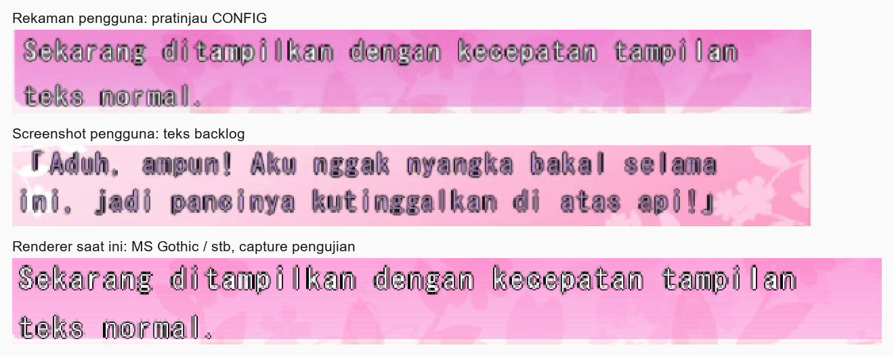

# Analisis keterbacaan MS Gothic pada CONFIG dan backlog DC2DM

Tanggal: 10 November 2026. Mode antislop: `during` (pilihan pengguna untuk sesi ini).

Analisis memakai kode di `E:\Games\Adv32roid`, commit dasar `812fb13`. Folder chat di OneDrive hanya berisi repositori kosong. Tidak ada perubahan kode aplikasi, pengaturan font, APK, atau save pada analisis ini.

## Kesimpulan

Keluhan pada rekaman sesuai dengan kombinasi glyph Latin kecil, jarak huruf tetap yang relatif lebar, outline hitam, dan pembesaran nearest-neighbor sebesar 1,25 kali. CONFIG dan backlog memakai kombinasi tersebut. Perilaku kode ini terkonfirmasi; besarnya kontribusi setiap faktor belum dipisahkan melalui perbandingan implementasi alternatif.

Rekaman tidak menunjukkan perpindahan posisi awal teks. Animasi menambah karakter di posisi tetap, menahan kalimat lengkap, lalu mengulang. Kekasaran tepi huruf juga terlihat saat kalimat sudah lengkap.

Ketiga potongan diperbesar 2 kali dengan nearest-neighbor untuk memperlihatkan piksel. Ukuran sumber berbeda: video 1468x662, screenshot 1456x653, dan capture pengujian 1280x720. Gambar ini menunjukkan ciri visual yang sama, bukan perbandingan piksel identik atau hasil sebelum/sesudah perbaikan.

## Bukti visual dan gerakan

- Video sumber: `20261109-0430-59.0679785.mp4`, 397 frame, 30 fps, durasi aliran video 13,2333 detik.
- Screenshot sumber: `codex-clipboard-73f4e539-e2a6-4b86-9ff6-696a6317fbc9.png`.
- Pemeriksaan temporal membaca crop `(550,484,650,64)` pada seluruh frame video. Mask piksel gelap memakai `max(R,G,B) < 115`.
- Pada prefix crop 78x28, batas kiri dan atas tetap `(11,8)` pada seluruh 397 frame. Batas penuh prefix `(11,8)-(73,25)` muncul pada 390 frame; tujuh frame lain berisi prefix yang masih pendek setelah pengulangan. Ini mendukung kestabilan posisi awal, bukan bukti bahwa setiap piksel antialias identik.
- Pengulangan terdeteksi sekitar detik 4,8667 dan 10,9667. Kalimat yang sudah lengkap tetap memiliki tepi huruf kasar/rangkap sebelum pengulangan tersebut.
- Kompresi video dan penyesuaian ukuran tampilan dapat mengubah tepi piksel. Karena itu, diagnosis juga memakai capture renderer tanpa kompresi video.

## Jalur kode yang menjelaskan gejala

| Faktor | Bukti | Dampak |
|---|---|---|
| Glyph 17 px, grid nominal 22 px | `core/src/system_menu.cpp:2470` memakai raster `22*15/19`; `core/src/scene.cpp:329` mengubahnya menjadi integer 17. `core/src/log_screen.cpp:501` langsung memakai raster 17 untuk Latin. | Isi huruf kecil dibanding ruang tata letaknya. |
| Jarak Latin tetap 10 px | Kedua pemanggil memakai fixed grid dan tracking -1. Rumus di `core/src/scene.cpp:379` adalah `22/2-1`. | Huruf sempit seperti i dan l mendapat jarak maju yang sama dengan huruf lebar. |
| Pembesaran pecahan dengan nearest-neighbor | Preview melewati `core/src/system_menu.cpp:2483`, `:346`, dan `:242`. Backlog menyalin sumber dengan `x*4/5` dan `y*4/5` di `core/src/log_screen.cpp:557`. | Empat piksel sumber menjadi lima piksel keluaran. Sebagian kolom/baris digandakan; sebagian tidak. Ketebalan garis tipis dapat terlihat berbeda menurut posisinya. |
| Outline mengelilingi glyph | `core/src/scene.cpp:342` memperluas coverage satu piksel ke empat arah untuk outline hitam. | Pada glyph kecil, kontur gelap menonjol dibanding isi huruf. |
| Raster Android berbeda dari GDI Windows | GDI dibatasi `_WIN32`; jalur portabel memakai `stbtt_MakeCodepointBitmap` di `core/src/scene.cpp:313`. `third_party/stb/stb_truetype.h:231` menjelaskan raster antialias tanpa hinting. | Nama font dan ukuran nominal yang sama tidak menjamin bentuk piksel identik dengan PC. |
| Penyajian Android menskalakan frame lagi | `FrameFilter.java:17` menetapkan default bilinear; `GlesFrameRenderer.java:144` memilih nearest saat filter off dan linear untuk mode lain. | Filter terakhir dapat melembutkan atau mempertajam hasil, tetapi tidak mengembalikan informasi yang sudah hilang pada pembesaran pertama. Filter yang dipilih saat perekaman belum diketahui. |

Dialogue memakai fungsi blit bilinear di `core/src/scene.cpp:181`, termasuk pembesaran DC2DM di `:3791`. Dengan demikian, ukuran dan font yang sama belum tentu menghasilkan ketajaman sama pada dialogue, preview CONFIG, dan backlog.

Pemilihan TTC face DC2DM adalah indeks 0 di `android/app/src/main/cpp/arisa32_jni.cpp:1009`. Tidak ditemukan bukti kesalahan pemilihan MS UI Gothic atau MS PGothic pada cabang ini. Keberhasilan load file yang digunakan APK saat merekam belum diperiksa ulang.

## Ukuran kecil memiliki alasan kompatibilitas

[Dokumentasi backlog native](dc2dm-native-backlog.md) mencatat patch PC dengan `DialogueSize=-15`: permintaan font 44 px menjadi 34 px, lalu game mengurangi hasilnya menjadi setengah. Advance Latin tetap 10 px. Renderer Arisa32 mendekati ukuran akhirnya dengan raster langsung 17 px.

Pendekatan itu mempertahankan ukuran dan ruang teks, tetapi raster GDI besar yang kemudian diperkecil tidak identik dengan raster stb langsung pada 17 px. Karena itu, mengganti ukuran nominal 22 atau menghapus faktor 15/19 untuk semua teks bukan langkah pertama yang tepat.

Dokumentasi yang sama mencatat native PC menggunakan salinan hitam ber-offset `(1,1)` sebagai shadow. Renderer bersama Arisa32 memakai outline satu piksel di sekeliling huruf. Perbedaan tersebut juga dapat memengaruhi kesan rangkap.

Nama yang menyatu dengan portrait speaker dikenal berasal dari atlas `LOG_CHIP.CRX` (`core/src/log_screen.cpp:518`). Hanya nama speaker yang tidak dikenali yang diraster ulang, dengan raster Latin 12 px (`:528`). Temuan utama pada screenshot ini menyangkut isi dialog backlog.

## Warna backlog

Baris normal memakai isi lavender `#C8A0DC`; baris terpilih memakai putih. Tiga sampel latar pink dari screenshot memberi rasio isi lavender terhadap latar sekitar 1,39 hingga 1,57; isi putih sekitar 1,40 hingga 1,59. Outline hitam terhadap sampel latar yang sama sekitar 13,19 hingga 14,97.

Angka dihitung dari formula luminansi WCAG pada koordinat `(750,385)`, `(900,380)`, dan `(1100,380)`, dengan RGB latar masing-masing `(252,205,226)`, `(253,186,216)`, dan `(255,199,228)`. Sampel ini menunjukkan bahwa kontur gelap banyak membantu keterbacaan. Angka tersebut bukan audit AA lengkap: antialias, seluruh variasi latar, dan kombinasi isi/outline belum dinilai sebagai satu kesatuan. Menghapus outline begitu saja berisiko membuat teks makin sulit dibaca.

## Validasi yang dijalankan

Build memakai kembali `build/desktop`. Perintah `cmake --build build/desktop --target dc2dm_menu_test log_screen_test text_render_test` berhasil; Ninja melaporkan tidak ada pekerjaan karena target sudah mutakhir.

| Pengujian | Konfigurasi | Hasil |
|---|---|---|
| `dc2dm_menu_test` | MS Gothic `C:\Windows\Fonts\msgothic.ttc`, jalur stb; data `H:\Games\DC2DM\AdvData`; capture ke Temp | Exit 0, termasuk fixture preview dan pemeriksaan data game. Capture CONFIG diperiksa visual. |
| `log_screen_test` | MS Gothic, jalur stb, fixture terisolasi | Exit 0; `Log regressions passed`. |
| `text_render_test` | MS Gothic, jalur stb, fixture terisolasi | Exit 0; `Text rendering passed`. |

Tes tersebut memeriksa konsistensi tata letak, warna, batas teks, dan perilaku. Expected image preview juga dibangun dari raster 17 px dan nearest-neighbor, sehingga tes bisa lulus walaupun pengguna menilai huruf kurang nyaman dibaca. Tidak ada benchmark FPS atau pengujian APK baru pada perangkat. Capture stb desktop membantu memeriksa raster portabel, tetapi bukan pengganti verifikasi penyajian akhir di HP.

Bukti terpilih disimpan bersama laporan ini. Pembersihan capture sementara ditolak peninjauan persetujuan otomatis dengan alasan `blocked by policy`; berkas antara tetap berada di `C:\Users\adamb\AppData\Local\Temp\arisa32-dc2dm-font-analysis-87b2dc9598ff440e839adc2cfc17ed1b`. Perintah yang ditolak tidak dijalankan; bukti kemudian disalin dengan perintah terpisah tanpa penghapusan.

## Urutan perbaikan yang disarankan

1. Pisahkan kualitas raster dan pembesaran dari tata letak. Bandingkan teks yang sama memakai jalur saat ini, bilinear untuk lapisan teks, dan raster pada resolusi keluaran atau supersampling. Pertahankan font, advance, baseline, line spacing, warna, serta waktu reveal selama perbandingan pertama. Bilinear mungkin lebih halus tetapi juga lebih lembut; raster resolusi keluaran perlu pemeriksaan baseline dan batas teks.
2. Setelah itu, evaluasi kekuatan isi glyph dan outline/shadow khusus teks Latin DC2DM. Pertahankan keterbacaan di atas bagian pink yang paling terang. Perubahan raster bersama berpotensi memengaruhi profil lain, sehingga gunakan batas perubahan yang jelas.
3. Bila huruf masih terasa terlalu kecil/renggang, uji penyesuaian raster dan jarak Latin sebagai perubahan terpisah. Verifikasi dua baris preview, baris backlog panjang, karakter bertangkai bawah, tanda kutip Jepang dalam terjemahan, serta Japanese asli.

Prioritas pertama adalah kualitas render teks pada CONFIG dan backlog. Animasi reveal tidak memerlukan perubahan berdasarkan bukti saat ini. Rekomendasi di atas belum diimplementasikan atau dinyatakan sebagai perbaikan teruji.

## Delivery Gate antislop untuk hasil analisis

Gate ini menilai ketepatan laporan dan bukti. Tidak ada UI baru yang diserahkan atau klaim bahwa UI lama telah lolos audit aksesibilitas menyeluruh.

| Pemeriksaan yang berlaku | Status dan bukti |
|---|---|
| Mode | PASS: pengguna memilih during pada sesi ini. |
| R-06, tipografi | PASS untuk diagnosis: ukuran glyph, advance, dan tujuan kompatibilitas dicatat dari jalur kode konkret. |
| R-19, gerakan | PASS untuk diagnosis: 397 frame diperiksa; prefix tetap pada koordinat yang sama dan kode hanya menambah karakter. |
| R-23 / R-38, bukti visual | PASS: gambar berasal dari rekaman, screenshot, dan capture renderer; pembesaran serta batas perbandingan dijelaskan. Tidak ada aset produk baru. |
| R-25, kontras | PASS untuk pengukuran terbatas: sampel, formula, dan rasio dicatat; tidak mengklaim AA keseluruhan. |
| R-35, verifikasi | PASS untuk analisis: target build diperiksa, tiga executable pengujian selesai exit 0, capture diperiksa. Tidak mengklaim klik perangkat atau APK baru. |
| R-36 / C-5, klaim | PASS: perilaku kode, hasil pengukuran, hipotesis kontribusi visual, dan rekomendasi yang belum diuji dipisahkan. |
| R-37, arah | PASS dalam cakupan analisis: referensi adalah UI DC2DM milik pengguna. Rekomendasi mempertahankan artwork, susunan asli, dan reveal untuk pratinjau kecepatan. Tidak menghasilkan desain baru. |
| Hard Gate lain, Purpose-Gate lain, dials/liveliness, kontrol, tema, dan layout produk | Tidak berlaku pada perubahan: laporan ini tidak membuat atau mengubah elemen produk. Temuan keterbacaan pada UI lama tetap merupakan pekerjaan perbaikan yang terbuka. |
