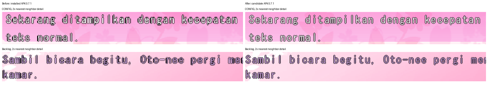

# Perbaikan MS Gothic DC2DM, 10 November 2026

Render Latin pada pratinjau CONFIG dan backlog sudah diperbaiki, APK berhasil dibangun, dan pembaruan terpasang pada iQOO I2219. Aplikasi dibuka kembali dengan normal. Sembilan berkas save/config eksternal memiliki hash yang identik sebelum dan sesudah pemasangan.

Font tetap MS Gothic. Layout memakai grid, baseline, jarak baris, warna, dan waktu reveal asli. Perubahan mengganti raster 17 piksel yang sebelumnya diperbesar nearest dari canvas 1024×576 dengan raster 21 piksel langsung pada keluaran 1280×720. Advance tetap dihitung pada grid native 10 piksel; setiap posisi kumulatif dipetakan ke keluaran agar pembulatan tidak menumpuk. Outline hitam menjadi satu piksel keluaran.

Guard memakai nama PostScript `MS-Gothic`, sehingga font impor yang diganti nama tetap dikenali. Jalur ini berlaku untuk Latin DC2DM: preview, isi backlog, nama fallback, dan pesan backlog kosong. Rendering Jepang dan font lain mempertahankan jalur sebelumnya. Nama panjang tetap berada di belakang ikon suara.



Kiri berasal dari APK yang terpasang sebelumnya; kanan dari APK baru yang kini terpasang. Keduanya memakai MS Gothic dan teks yang sama pada HP. Potongan diperbesar 2× dengan nearest agar struktur piksel terlihat. Ini merupakan capture framebuffer JNI, bukan screenshot akhir filter GLES.

| Pemeriksaan | Hasil |
|---|---|
| `dc2dm_menu_test` | PASS, termasuk data game asli, timing/restart/reveal, prefix stabil, batas dua baris, Jepang, serta face lain |
| `log_screen_test` | PASS, empat baris dialog × empat baris teks, wrap 50 karakter, warna seleksi, scroll, empty state, nama fallback, serta ikon utuh pada nama 24 karakter |
| `text_render_test` | PASS, identitas/rename/reload font, default scale, posisi kumulatif, outline, clipping, dan kontrol dialog |
| `dc2dm_font_test` | PASS, MS Gothic stb/GDI dan Pretendard, Latin/Jepang, dengan kontrol DC2DM/DC2PC/DC4 |
| Probe Android `text-render` | PASS memakai library arm64 persis dari APK baru, salinan save dan konfigurasi terpisah; CONFIG awal/tengah/penuh/hold/restart serta tujuh dialog backlog normal/selected/scrolled |
| Probe APK baseline | PASS dengan fixture yang sama; menjadi pembanding gambar |
| Perbandingan gambar | 7.873 piksel CONFIG berubah hanya pada area teks `(462,534)..(1037,590)`; 17.515 piksel backlog normal berubah hanya pada teks. Artwork/kontrol identik. 37 capture menu desktop lain identik |
| Build | `gradlew.bat assembleDebug --console=plain`, sukses; `arm64-v8a` dan `armeabi-v7a` |
| Pemasangan | `adb install -r`, sukses. Sertifikat sama. Hash APK di HP sama dengan hasil build |
| Startup | Activity terbuka ke Game Library, proses hidup, tidak ada penanda fatal pada log startup yang diperiksa |
| Save/config eksternal | 9 berkas, manifest SHA-256 identik sebelum/sesudah install |
| Patch | `git diff --check` lulus |

APK berada di `android/app/build/outputs/apk/debug/app-debug.apk`, 17.433.532 byte. Build ini varian debug, versi tetap 0.7.1 / code 19; identitas build dibedakan oleh hash berikut.

```text
APK SHA256
800fcca67e17f46ae05d99bc5a3813faa4859fa97edef4e6075d1e94c403318e

lib/arm64-v8a/libarisa32.so SHA256
ab2129020a9a64f6bbb317d7a3e70577bb3ff0548e9541ba0844ae10e5cd5c63

lib/armeabi-v7a/libarisa32.so SHA256
6e937809f98dd27de68711a257944196b3955a4015bcef99bedd3ed3d7fa6195

Signing certificate SHA256
6cda1050c64fb9433f07095ab88027c2a521452ec219e9849279e26704acf686

External save/config manifest SHA256
accbfae911e349cfa4b845c1e1cc35464e0c607d7de9b61745e46f11ce341e23
```

Pengaturan library DC2DM setelah pemasangan tetap menunjuk `files/fonts/MSGOTHIC.TTC`. Konfigurasi privat sebelum pemasangan tidak dapat di-hash karena APK lama tidak debuggable. Verifikasi byte-identik data dibatasi pada sembilan berkas eksternal tersebut. Runtime perangkat diuji pada arm64; ABI 32-bit dibangun tetapi tidak dijalankan terpisah. Filter GLES dan panel HP dapat memengaruhi tampilan akhir; keterbacaan CONFIG/backlog dinilai dari framebuffer JNI, sedangkan pemeriksaan Activity terpasang mencakup startup/library.

Antislop during, cakupan perbaikan renderer:

- PASS R-02: tidak ada copy produk baru atau tanda em dash baru.
- PASS R-03: fixture empat baris dan capture HP menunjukkan teks berada di area yang ditentukan.
- PASS R-17/R-18: tidak ada statistik pemasaran atau testimonial; angka laporan berasal dari pengujian.
- PASS R-23/R-24: artwork dan navigasi asli digunakan kembali, tanpa aset atau tujuan navigasi baru.
- PASS R-25: palet asli putih/lavender dipertahankan dengan outline hitam; kontras terhadap outline masing-masing 21:1 dan 9,52:1. Ini bukan audit aksesibilitas seluruh artwork lama.
- PASS R-26: reveal, restart, seleksi, scroll, dan ikon suara diuji.
- PASS R-27/R-28: empty state backlog diuji; tidak ada FAQ, form, atau state jaringan baru.
- PASS R-01/R-04/R-06/R-07/R-08/R-09/R-10/R-12/R-13/R-14/R-19/R-22: tidak menambahkan efek dekoratif; MS Gothic, palet, motif bunga, dan komposisi merupakan identitas game asli.
- PASS dials: arah perbaikan menu game asli untuk pemain DC2DM, ENERGY 1 / RHYTHM 1 / MOTION 1 pada perubahan ini; animasi hanya reveal fungsional yang sudah ada.
- PASS focal point: area preview mencontohkan kecepatan teks; baris backlog terpilih memakai putih.
- PASS whitespace/accent/identity: grid asli dan jarak baris dipertahankan, palet seleksi asli diuji, MS Gothic tetap menjadi identitas tipografi.
- PASS C-1/C-2/C-3/C-4/C-5: perubahan didasarkan pada bukti raster, kontrol tetap berfungsi, batas/seleksi/empty state diuji, dan klaim dibatasi oleh bukti.
- PASS R-05/R-11/R-15/R-16/R-20/R-21/R-29/R-30/R-31: tidak menambah struktur, CTA, tema, atau komponen; alasan perubahan adalah menghilangkan pembesaran nearest pada raster kecil.
- PASS comment hygiene: komentar baru menjelaskan kontrak skala serta alasan alignment strip empat piksel.

Capture/log sementara berada di Temp Windows. Bukti terpilih disimpan bersama laporan ini; hasil analisis awal tetap tersedia di [laporan analisis](dc2dm-msgothic-readability-analysis.md).
