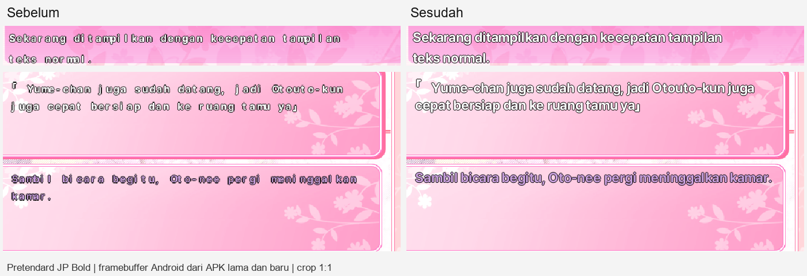
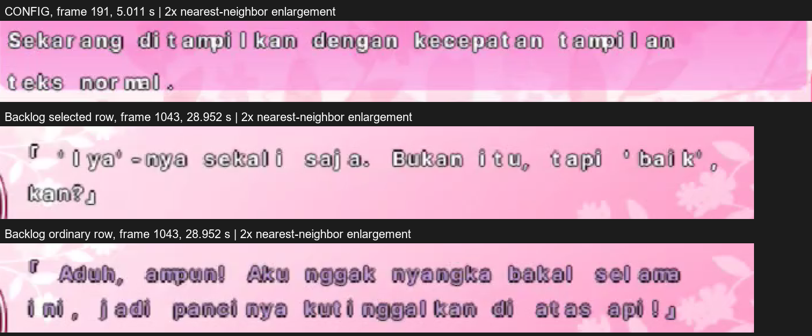

# Pretendard JP Bold: CONFIG dan backlog DC2DM

Perbaikan 10 November 2026. APK sudah dibangun, diuji, dan dipasang pada iQOO I2219. Sesuai arahan pengguna yang sedang menonton YouTube, pemasangan berlangsung tanpa membuka Activity game atau mengendalikan layar. Verifikasi tampilan menggunakan rekaman pengguna, renderer desktop, dan framebuffer JNI dari APK pada proses pengujian terpisah.



## Pemeriksaan rekaman

Sumber: `C:\Users\adamb\Downloads\Screenrecording_20261110_120614.mp4`, 6.408.389 byte, durasi 40,379 detik. Video tersimpan 720×1606 dengan rotasi −90°, ditampilkan 1606×720. Area game x169–1448 mempertahankan resolusi 1280×720.

Seluruh **1.297 frame** didekode berurutan dua kali dan dihitung terhadap timestamp FFprobe. Pengukuran mencakup setiap frame, termasuk mask teks pada 589 frame CONFIG dan 182 frame backlog. Pemeriksaan visual memakai 41 sampel keseluruhan, 52 perubahan reveal, dan crop terpilih pada resolusi asli. Ini bukan klaim bahwa seluruh 1.297 gambar penuh dilihat satu per satu.

| Frame / waktu PTS | Temuan |
|---|---|
| 0–588 / 0–17,100 dtk | CONFIG: huruf kecil dan jarak berlebihan di sekitar `i`/`l`, misalnya `ditampilkan`; outline memenuhi interior huruf kecil |
| 101, 331, 524 / 2,633; 8,697; 14,763 dtk | Preview mengulang sekitar setiap 6,065 detik; pengulangan ini bukan bukti teks macet |
| Seluruh 589 frame CONFIG | Piksel gelap paling kiri tetap x634 pada rekaman; tidak terlihat perpindahan origin atau clipping pada crop yang ditinjau |
| 1030–1153 / 28,048–36,115 dtk | Backlog pertama: masalah ukuran/jarak terjadi pada teks putih terpilih maupun lavender biasa; batas mask tetap |
| 1239–1296 / 37,935–40,286 dtk | Backlog dibuka kembali; masalah yang sama terlihat, tanpa baris bertumpuk |

Mask video tidak dipakai untuk mengklaim kestabilan subpiksel: kompresi H.264 dapat mengubah piksel meskipun isi tetap. Kecepatan rekaman backlog statis sekitar 8,67 FPS meningkat ketika ada interaksi; ini tidak membuktikan masalah performa font. Perbaikan ini membahas keterbacaan.



## Penyebab dan perubahan

Dialog utama sudah mengenali nama PostScript `PretendardJP-Bold` dan memakai advance proporsional. Preview CONFIG dan backlog masih memaksa grid setengah/lebar penuh, tracking −1, serta raster Latin 17 piksel yang kemudian diperbesar dari canvas 1024×576. Nama fallback memakai raster 12 piksel. Pengaturan tersebut membuat Pretendard kecil dan tampak terpisah di dalam kata.

- CONFIG memakai advance proporsional, tracking 0, ukuran logis 22, dan raster langsung pada keluaran 1,25× (28 piksel). Posisi, newline yang ditulis game, jarak baris 29, reveal, hold, dan restart dipertahankan.
- Backlog memakai ukuran logis 22 untuk isi dan 16 untuk nama (raster keluaran 28/20). Wrap dihitung dengan advance font pada lebar native 506. Contoh: 28 huruf `W` muat satu baris, sedangkan `i` jauh lebih sempit; hitungan karakter tetap tidak cocok.
- Nama fallback memakai lebar terukur pada pusat area native. Nama ekstrem dibatasi pada x200–364 agar tidak melukis di luar area nama; ikon suara tetap di atas nama. Nama biasa tetap terbaca lengkap.
- Profil Pretendard juga berlaku untuk Jepang, mengikuti identitas font seperti dialog utama. Newline Jepang dipertahankan, dengan jarak baris native 32. Latin mempertahankan jarak baris 24.
- Perbaikan MS Gothic sebelumnya, artwork, warna seleksi, dan perilaku sentuh/cursor tetap dipertahankan.

## Verifikasi

| Pemeriksaan | Hasil |
|---|---|
| `dc2dm_menu_test` dengan MS Gothic dan Pretendard | PASS, termasuk game asli, reveal/hold/restart, prefix stabil, huruf sempit/lebar, tiga baris, Jepang, dan kontrol menu lain |
| `log_screen_test` dengan kedua font | PASS: wrap proporsional, 16 baris Latin dalam empat panel, descender, Jepang, nama biasa/panjang, ikon suara, empty state, warna seleksi |
| `text_render_test` | PASS |
| `dc2dm_font_test` | PASS: dialog/pilihan DC2DM, DC2PC, DC4; MS Gothic stb/GDI dan Pretendard, Latin/Jepang |
| Android `text-render` dari APK persis | PASS: CONFIG awal/tengah/penuh/hold/restart dan tujuh entri save salinan, backlog normal/selected/scrolled |
| Android `backlog-input` dengan Pretendard | PASS: 1–4 baris, tap cepat, gerakan jari, reopen, panah/swipe/scrollbar, kedua mode cursor, batal Baca dari sini, clear |
| Perbandingan framebuffer APK lama/baru | CONFIG penuh berubah 10.293 piksel pada area teks; backlog normal 24.993 piksel. Artwork tidak berubah pada capture yang dibandingkan |
| Perbandingan 42 capture menu desktop | 37 identik; 5 perubahan berada pada area preview CONFIG |
| Build | `build.bat` dan `gradlew.bat assembleDebug --console=plain` PASS, arm64-v8a + armeabi-v7a |
| Patch | `git diff --check` PASS |
| Install | `adb install -r` Success; hash APK pada HP identik dengan APK yang diuji |
| Perlindungan data | 5 berkas privat dan 9 berkas save/config eksternal identik sebelum/sesudah; snapshot baru diambil tepat sebelum install |

Runtime arm64 diuji dalam proses terpisah menggunakan salinan save. ABI 32-bit dibangun, tidak dieksekusi terpisah. Activity/GLES akhir tidak dibuka ulang karena pengguna sedang memakai HP. Screenshot bukti berasal dari framebuffer renderer, bukan capture layar YouTube atau hasil filter panel HP.

APK: `android/app/build/outputs/apk/debug/app-debug.apk`, 19.463.299 byte, versi 0.7.1 / code 19.

```text
APK SHA256
3a39c73ad39a421da5e844f8f6c64e818d9b80a4e528902d5919e87ee384f9d1

arm64 libarisa32.so SHA256
47f7cc7f1ae6db30ab2b126b54e9952878d6025d2d8059cbddfbc4f5cd90db6f

armeabi-v7a libarisa32.so SHA256
edae42b957052c7a8471a0ca5f97feab6eaa1c1982e2bdd73ffe1a18a973e47d
```

Pengujian CTest kini mendaftarkan `dc2dm_menu_pretendard_test` dan memasok kedua font pada `log_screen_test`, sehingga coverage ini ikut pemeriksaan biasa.

## Antislop during: delivery gate

Arah berasal dari permintaan pengguna: mempertahankan game DC2DM dan font Pretendard JP Bold, memperbaiki keterbacaan. Tidak ada perubahan identitas visual atau aset game.

- Hard gate PASS dalam cakupan perubahan: tes ukuran, wrap, clipping, reveal, interaksi, dan APK dijalankan. Teks putih/lavender memakai outline hitam asli; kontras warna isi terhadap hitam 21:1 / 9,52:1. Ini bukan audit aksesibilitas seluruh artwork game.
- Purpose gate PASS: tipe huruf pilihan pengguna dipertahankan; grid, ornamen, palet, dan navigasi berasal dari game. Tidak ada efek, statistik produk, atau copy baru.
- Liveliness gate PASS: perbaikan mengikuti komposisi native, ENERGY 1 / RHYTHM 1 / MOTION 1 untuk perubahan ini; animasi preview tetap menjelaskan pengaturan kecepatan teks.
- Craftsmanship gate PASS: kasus huruf lebar/sempit, state kosong/terpilih, ikon suara, cursor ON/OFF, dan font lain diuji. Klaim visual dibatasi pada rekaman dan framebuffer yang diperiksa; tidak mengklaim pengujian Activity akhir.

Capture, metrik seluruh frame, APK pembanding, dan snapshot data disimpan sementara di:

- `%TEMP%\arisa32-pretendard-video-7c3f85684462483b8f7dc8ec4138b3bf`
- `%TEMP%\arisa32-pretendard-fix-b53d6f091a9043a9ae577540162d09d0`

Hanya dua gambar bukti terpilih dan laporan ini disimpan di `docs/`.
