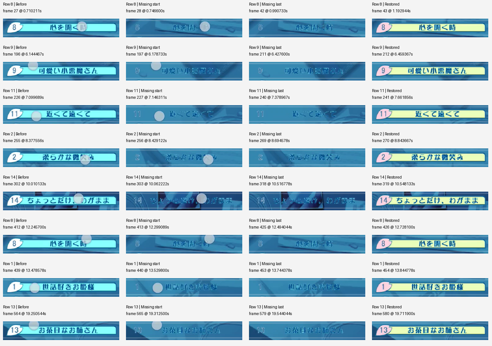
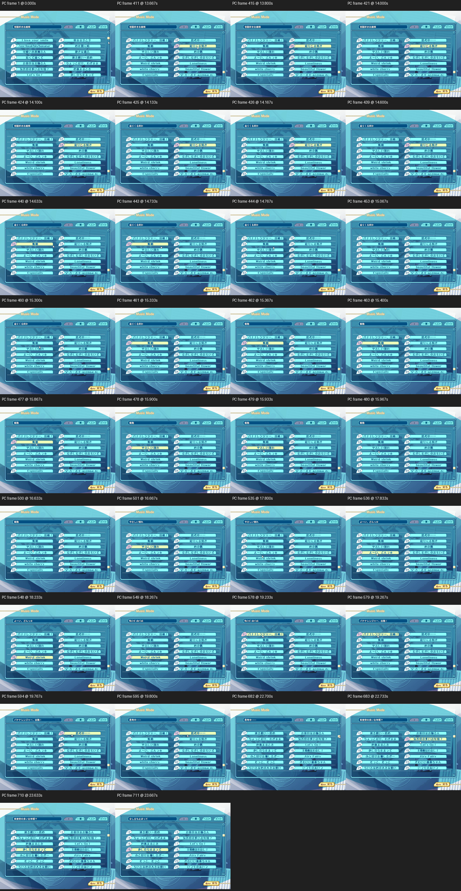

# Analisis frame Music Mode DC2PC

14 November 2026. Lingkup: profil Da Capo 2 Plus Communication (DC2PC).

## Hasil

Ada dua kekurangan terpisah dalam implementasi menu DC2PC. Kotak atas sudah ada, tetapi judul lagu pilihan belum digambar. Latar baris yang tampak transparan sebenarnya tidak digambar selama penekanan, sementara nomor dan judulnya tetap digambar di atas latar menu.

Analisis ini tidak mengubah kode aplikasi, membangun APK, atau memasang aplikasi. Referensi perilakunya adalah rekaman dan executable PC milik pengguna.

## Cakupan dan metode

| Sumber di `C:/Users/adamb/Downloads/` | Frame didekode | Durasi kontainer | PTS frame terakhir |
| --- | ---: | ---: | ---: |
| `dc2pcmusicmode_arisa32_version.mp4.mp4` | 671 | 23,998396 s | 23,931056 s |
| `dc2pcmusicmode_pc_version.mp4` | 989 | 32,966633 s | 32,933333 s |

Seluruh **1.660 frame** didekode secara berurutan, tanpa sampling waktu atau konversi ke frame rate tetap. Jumlah hasil decode dicocokkan dengan jumlah timestamp dari `ffprobe`. Nomor frame dalam laporan ini dimulai dari **1**; CSV diagnostik memakai indeks mulai 0.

Orientasi Arisa32 dikoreksi mengikuti metadata rotasi video. Area permainan Arisa32 dipotong `(329,0,960,720)`. Area permainan PC dipotong `(0,23,796,599)` untuk mengeluarkan bilah judul jendela. Keduanya dinormalisasi menjadi 800x600 hanya untuk pengukuran area. Urutan klik kedua video berbeda, sehingga timestamp kedua video tidak diperlakukan sebagai adegan yang tersinkronisasi.

Pada setiap frame diperiksa perubahan piksel, keberadaan tulisan terang di kotak judul, serta warna latar dan sorotan pada seluruh 14 slot daftar yang terlihat. Deteksi hilangnya latar menggunakan proporsi piksel terang pada badan baris, bukan hanya perbedaan seluruh frame. Semua delapan kejadian kemudian diperiksa secara visual pada frame sebelum, awal kehilangan, akhir kehilangan, dan pemulihan. Frame sekitar seluruh sembilan perubahan judul PC juga diperiksa secara visual. Ini bukan klaim bahwa seluruh 1.660 frame diperiksa satu per satu dengan mata; semuanya diukur, lalu batas kejadian diverifikasi secara visual.

Video Arisa32 mempunyai jarak timestamp yang bervariasi. Awal kejadian di tabel berarti frame pertama yang memperlihatkan masalah; waktu pulih adalah frame pertama yang memperlihatkan latar kembali. Waktu input fisik tidak dapat ditentukan lebih presisi daripada rekaman.

## Seluruh kejadian latar hilang pada Arisa32

Nomor lagu tetap sama dengan nomor slot selama delapan kejadian ini; daftar Arisa32 masih menampilkan lagu 1–14.

| Lagu | Frame yang kehilangan latar, inklusif | Mulai terlihat hilang | Frame pertama pulih | Waktu pulih |
| ---: | --- | ---: | ---: | ---: |
| 8 | 28–42 | 0,746600 s | 43 | 1,192944 s |
| 9 | 197–211 | 6,178733 s | 212 | 6,459367 s |
| 11 | 227–240 | 7,146311 s | 241 | 7,661856 s |
| 2 | 256–269 | 8,429122 s | 270 | 8,843667 s |
| 14 | 303–318 | 10,062222 s | 319 | 10,548133 s |
| 8 | 413–425 | 12,299089 s | 426 | 12,728100 s |
| 1 | 440–453 | 13,529800 s | 454 | 13,844778 s |
| 13 | 565–579 | 19,312500 s | 580 | 19,711900 s |

Totalnya **116 frame dalam 8 kejadian**. Contoh pertama: frame 27 masih berlatar sian; frame 28 kehilangan latar baris 8; nomor dan judul tetap ada; frame 43 kembali menampilkan sorotan kuning. Lingkaran indikator sentuhan pada rekaman bertepatan dengan awal kejadian, tetapi bukan pengukuran waktu input dari engine.

Tidak ditemukan latar baris hilang dalam 989 frame PC. Perubahan kuning menjadi sian ketika pointer keluar dari area baris adalah perilaku normal, bukan transparansi. Contohnya frame PC 444 pada 14,766667 s: pointer berada di sela baris, sehingga sorotan menghilang tetapi latar sian tetap ada.

## Kotak judul atas

Arisa32: area teks kotak atas kosong pada seluruh 671 frame, termasuk setelah setiap pemilihan lagu. Dalam area ukur `(100,101)..(422,117)`, jumlah piksel tulisan terang adalah 0 pada setiap frame. Bentuk dan warna kotaknya sendiri tetap terlihat.

PC: judul terlihat pada seluruh 989 frame. Terdapat sembilan perubahan judul, pada frame/waktu berikut:

| Frame PC | Waktu | Nomor lagu yang judulnya mulai ditampilkan |
| ---: | ---: | --- |
| 425 | 14,133333 s | 54 |
| 462 | 15,366667 s | 53 |
| 501 | 16,666667 s | 55 |
| 536 | 17,833333 s | 57 |
| 549 | 18,266667 s | 59 |
| 579 | 19,266667 s | 51 |
| 595 | 19,800000 s | 52 |
| 683 | 22,733333 s | 15 |
| 711 | 23,666667 s | 18 |

Judul awal adalah `世話好きお姫様`. Scroll dan perpindahan hover tidak otomatis mengganti judul atas. Karena itu kotak ini menunjukkan pilihan lagu, bukan nama baris yang kebetulan berada di bawah pointer.

## Penyebab dalam kode dan format asli

### Latar baris

`E:/Games/DC2PC/AdvData/MES/music.mes` mendefinisikan 14 slot di x75/x405, y187 + 40 per baris, berukuran 296x32. Slot pertama didefinisikan pada byte 876; chip pada byte 894 dan 912 menyediakan state **9** dan **1**. Tidak ada gambar state **2** pada slot musik tersebut.

`core/src/messtream.cpp:65` menormalkan state 9 menjadi 99. `core/src/system_menu.cpp:872` memilih state 2 ketika pointer sedang ditekan. Karena tidak ada chip yang cocok, latar dilewati. Judul daftar dirender terpisah dan tetap terlihat. Jalur penggambaran chip musik menggunakan alpha 255; perubahan opacity bukan penyebab gejala ini.

Pembacaan executable PC secara statis mengonfirmasi bahwa updater katalog di VA **0x412230** menggunakan state normal untuk baris di luar hover, dan memanggil **0x411AC0(control, 1, 0)** pada **0x41233E** untuk baris yang disorot. State 1 adalah konstanta di jalur katalog, bukan state yang berubah menjadi 2 ketika mouse ditekan. Kontrol generik mempunyai jalur berbeda, sehingga koreksi tidak boleh diterapkan secara global.

Baris terkunci tidak menjelaskan delapan kejadian ini. Slot tanpa tag dinonaktifkan oleh `legacy_list_rows()` dan tidak ikut hit-test; delapan kejadian terjadi pada lagu yang bisa dipilih.

### Judul pilihan

Judul atas DC2PC tidak dihasilkan oleh perintah gambar judul di `music.mes`. Executable asli menggambarnya langsung melalui fungsi **0x408A70**, dipanggil pada **0x408B26**:

- Pilihan lagu dibaca dari variabel **3[5]**.
- Tabel judul CP932 berada di **VA 0x536B28**, stride **260 byte**, dengan **74 judul**.
- Teks ukuran 16 digambar pada **(100,102)**, shadow pada **(101,103)**.
- Clip asli adalah **(96,100)..(428,118)**; foreground memakai palette 7 dan shadow palette 15.
- Fungsi judul tidak memeriksa variabel Stop 3[7], sehingga judul pilihan tidak perlu dikosongkan ketika Stop ditekan.

Dalam Arisa32, blok penggambaran judul pada `core/src/system_menu.cpp:2953` hanya menangani **DC2TY**. Belum ada padanannya untuk DC2PC. Tabel 48 judul dan posisi DC2TY tidak dapat digunakan sebagai pengganti tabel 74 judul dan posisi DC2PC.

## Koreksi yang diperlukan dan lingkup verifikasinya

1. Khusus baris katalog Music profil DC2PC, pertahankan state hover saat ditekan di dalam baris, mengikuti jalur katalog PC. Jangan mengubah tombol generik atau profil DC2TY.
2. Tambahkan penggambaran judul pilihan DC2PC dari 3[5] memakai tabel, ukuran, posisi, clip, dan shadow aslinya.
3. Uji piksel normal/hover/held, perubahan judul setelah memilih dua lagu, serta judul yang bertahan melalui hover, scroll dan Stop. Jalankan regresi DC2TY untuk memastikan profil itu tidak ikut berubah.

Tes yang tersedia di `tests/dc2pc_menu_test.cpp:669` sudah memeriksa aksi audio, repeat, Stop, scroll dan All Play, tetapi belum menguji piksel latar saat ditekan atau judul atas. Analisis ini belum menjalankan pengujian perbaikan karena kode aplikasi belum diubah.

Data numerik semua frame, script analisis sekali pakai, dan cuplikan sumber berada di direktori sementara tugas `C:/Users/adamb/AppData/Local/Temp/arisa32-dc2pc-music-v4y8l6qs/`. Hanya laporan dan dua lembar bukti terpilih yang disimpan di proyek.
