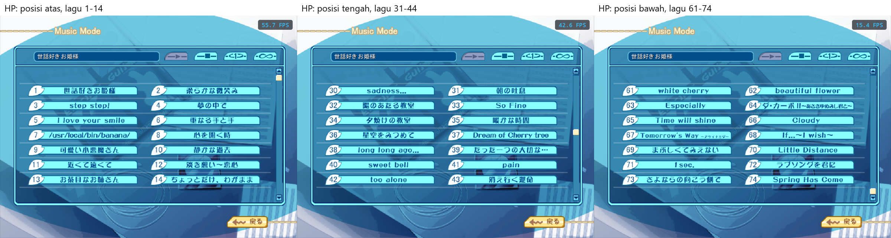
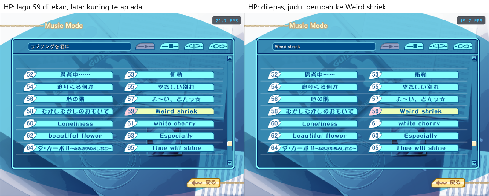

# Perbaikan Music Mode DC2PC

14 November 2026. Perbaikan lokal Arisa32 0.7.2, khusus Da Capo II Plus Communication.

Scrollbar putih/krem sekarang tampil dan dapat diseret. Judul lagu pilihan tampil di kotak atas, dan latar baris tetap kuning selama ditekan. APK yang memuat ketiga perubahan sudah dipasang ke HP pengguna dengan pembaruan di tempat (`adb install -r`), tanpa menghapus data aplikasi atau save.

## Penyebab dan perubahan

| Masalah | Penyebab | Perbaikan |
| --- | --- | --- |
| Pegangan scroll hilang | Kontrol raw55 dilewati pada semua halaman selain Scenes. | Music DC2PC membuat scrollbar vertikal dari raw55, terhubung ke indeks daftar `3[25]`. |
| Kotak judul kosong | Jalur gambar judul khusus DC2PC belum ada. | Menggambar judul dari `3[5]` memakai tabel 74 judul asli. |
| Latar baris hilang saat ditekan | Renderer memilih state 2, sedangkan aset baris Music hanya menyediakan normal dan state 1. | Baris yang ditekan mempertahankan artwork state 1, mengikuti katalog PC. |

Implementasi berada di `core/src/system_menu.cpp` dan `core/src/dc2pc_music.h`. Kondisi `dc2pc && !dc2ty` membatasi perubahan ke DC2PC karena flag internal `dc2pc` juga mencakup DC2TY. Jalur Scenes dan judul DC2TY tetap terpisah.

Rujukan data asli:

- Tabel judul CP932 dalam `DC2PC.exe`, VA `0x536B28`, stride 260 byte, 74 entri.
- Judul ukuran 16, foreground putih di `(100,102)`, shadow hitam di `(101,103)`, clip `(96,100)..(428,118)`.
- Scrollbar raw55 dalam `MES/music.mes`, batas `(740,160)..(756,482)`.
- Sprite pegangan dari `GRP/system/music_chip.crx`, crop `(72,216,16,16)`, digambar di x744. Posisi vertikal mengikuti `160 + floor(306 * indeks / 60)`.

## Verifikasi di HP

Perangkat I2219/iQOO Z9x menjalankan APK hasil build terakhir. Capture berikut diambil setelah pemasangan. Hanya area permainan yang dipotong dan diperkecil menjadi 800x600 per panel; isi gambar tidak diubah.



Seret dari tengah menuju bawah mencapai lagu 61-74, lalu seret kembali ke atas menampilkan lagu 1-14. Judul `世話好きお姫様` tetap tampil selama perpindahan daftar.



Saat lagu 59 ditekan, latar kuning tetap terlihat. Setelah dilepas, judul atas berubah menjadi `Weird shriek`. Pengguna juga berinteraksi dengan HP selama pemeriksaan, sehingga dua lembar bukti ini tidak diperlakukan sebagai satu urutan input yang berkesinambungan.

## Pengujian otomatis dan build

Lima target CTest lulus: `dc2pc_menu_test`, `dc2ty_menu_test`, `dc2dm_menu_test`, `system_menu_test`, dan `text_render_test`. Durasi keseluruhan 46,58 detik.

DC2PC dan DC2TY diuji dengan data game yang terpasang. DC2DM memakai fixture; pemeriksaan aset DC4 pada `system_menu_test` dilewati karena `DC4_TEST_DATA` tidak disetel. Hasil ini bukan pengujian semua game yang didukung.

Tambahan `music_visuals()` di `tests/dc2pc_menu_test.cpp` memeriksa:

- Seluruh 14 baris: normal, hover, ditekan, pointer keluar dan pembatalan.
- Pemilihan lagu mengubah judul; hover, scroll dan Stop mempertahankan judul.
- Seluruh 74 judul memakai MS Gothic dan Pretendard JP, termasuk batas clip dan indeks di luar katalog.
- Piksel sprite pada posisi atas/tengah/bawah, seret pegangan, isi daftar yang berubah dan judul yang tetap.
- Menu dibuka melalui Extras lalu Music agar sheet yang dipakai sama dengan jalur aplikasi.

Perintah verifikasi menggunakan direktori build yang sudah ada:

```powershell
$env:DC2PC_TEST_DATA='E:/Games/DC2PC/AdvData'
$env:DC2TY_DATA='E:/Games/DC2TY/AdvData'
ctest --test-dir build/desktop -R '^(dc2pc_menu_test|dc2ty_menu_test|dc2dm_menu_test|system_menu_test|text_render_test)$' --output-on-failure --parallel 2
```

Build Android `assembleDebug` berhasil untuk `arm64-v8a` dan `armeabi-v7a`. APK tetap memakai versi 0.7.2/code20; ini build perbaikan lokal, belum rilis GitHub.

APK: `android/app/build/outputs/apk/debug/app-debug.apk`.

SHA256 APK lokal dan `base.apk` yang terpasang cocok:

```text
3bd25358a4afd82828f299cc4b2e302a2a16d38704c23286341920f7591e0850
```

## Pemeriksaan visual dalam lingkup perubahan

Arah visual mengikuti menu PC asli: ENERGY 2 / RHYTHM 2 / MOTION 1. Artwork dua kolom, warna sian, sorotan kuning, motif CD dan bentuk pegangan berasal dari aset game. Tidak ada aset dekoratif baru.

- **Hard Gate PASS, lingkup perubahan:** isi judul bersumber dari executable; sprite berasal dari aset; build dan uji interaksi di atas berhasil; seluruh judul diuji terhadap clip. Kontras putih terhadap latar header terukur RGB `(0,78,138)` adalah 8,55:1.
- **Purpose Gate PASS:** kotak judul mengidentifikasi pilihan lagu, kuning menunjukkan baris yang ditekan, dan pegangan menunjukkan posisi sekaligus mengendalikan daftar.
- **Liveliness PASS:** susunan, warna, motif dan gerak mengikuti referensi PC yang diminta; penekanan dan seret memberikan umpan balik tanpa animasi tambahan.
- **Craftsmanship PASS, lingkup perubahan:** bukti mencakup pemilihan, penekanan, pembatalan, scroll dan Stop; regresi profil terkait lulus. Pemeriksaan ini tidak menyatakan audit aksesibilitas seluruh aplikasi atau semua ukuran layar.

Capture mentah tetap di direktori Temp tugas. Hanya dua lembar bukti terpilih dan laporan ini ditambahkan ke `docs/`. Analisis sebelum perbaikan tersedia di [dc2pc-music-mode-analysis.md](dc2pc-music-mode-analysis.md).
