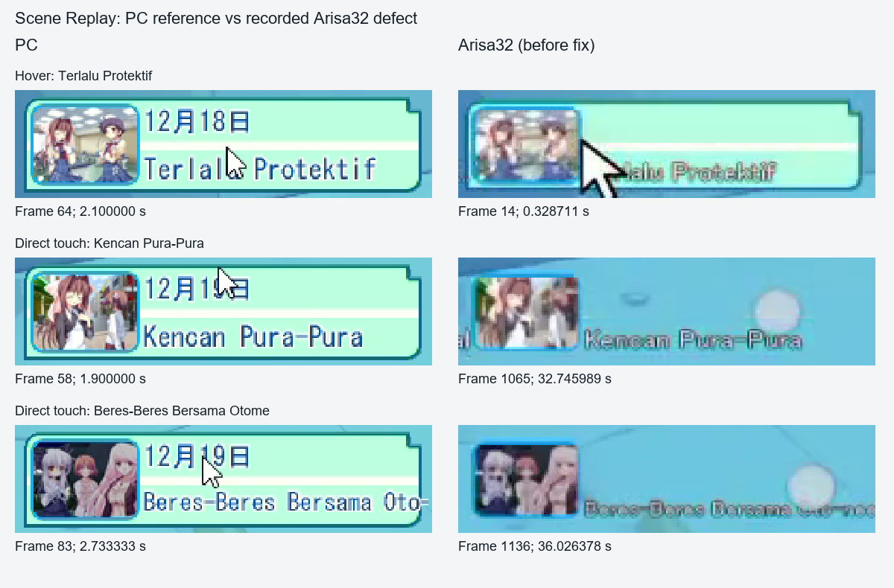

# Analisis frame Scene Replay DC2PC

Tanggal: 14 November 2026. Sumber: `Downloads/dc2pcscenereplay_arisa32_version.mp4` dan `Downloads/dc2pcscenereplay_pc_version.mp4`.

## Hasil

Seluruh 2.032 frame hasil decode dipindai: 1.279 Arisa32 dan 753 PC. Pemeriksaan memakai timestamp PTS setiap frame, bukan asumsi FPS tetap. Tanggal hilang pada 264 frame Arisa32 dalam 10 rentang kejadian. Dari jumlah itu, 185 frame masih memperlihatkan latar hover hijau muda, sedangkan 79 frame kehilangan latar kartu sekaligus tanggal. Thumbnail dan judul tetap terlihat pada kasus latar hilang.

Pada PC, seluruh 249 frame dengan menu terlihat penuh mempertahankan tanggal pada semua 10 kartu. Latar kartu yang diarahkan cursor berubah dari cyan ke hijau muda. Kartu beserta tanggal juga masih terlihat pada frame terakhir menu sebelum fade ke replay: f135 (4.466667 s) dan f570 (18.966667 s). Video saja tidak mengungkap timestamp mouse-down secara pasti.

## Kejadian Arisa32

Nomor frame di bawah berbasis 1. Akhir rentang adalah PTS frame terakhir yang menunjukkan masalah, bukan waktu selesai tampil frame tersebut. Rentang terakhir berlanjut sampai akhir video.

| Kartu | Frame | PTS mulai sampai akhir (detik) | Keadaan |
|---|---:|---:|---|
| Terlalu Protektif | 14-35 | 0.328711-1.115478 | Latar hijau muda; tanggal hilang |
| Kencan Pura-Pura | 46-65 | 1.665467-2.198967 | Latar hijau muda; tanggal hilang |
| Beres-Beres Bersama Otome | 72-118 | 2.480556-3.794067 | Latar hijau muda; tanggal hilang |
| Pengumuman Pesta Natal | 1062-1064 | 31.945922-32.462767 | Latar hijau muda; tanggal hilang |
| Kencan Pura-Pura | 1065-1089 | 32.745989-34.611922 | Latar kartu dan tanggal hilang saat sentuhan langsung |
| Beres-Beres Bersama Otome | 1090-1103 | 34.627089-34.893422 | Latar hijau muda; tanggal hilang |
| Beres-Beres Bersama Otome | 1136-1160 | 36.026378-37.062856 | Latar kartu dan tanggal hilang saat sentuhan langsung |
| Kencan Pura-Pura | 1161-1190 | 37.094667-37.896522 | Latar hijau muda; tanggal hilang |
| Beres-Beres Bersama Otome | 1202-1230 | 38.215767-39.050489 | Latar kartu dan tanggal hilang saat sentuhan langsung |
| Kencan Pura-Pura | 1231-1279 | 39.152400-41.853100 | Latar hijau muda; tanggal hilang |

Segmen awal memakai cursor. Prompt konfirmasi mulai terlihat pada f119 (4.081256 s); tanggal kartu yang sebelumnya diarahkan cursor pulih ketika dialog muncul. Dialog tampil sampai f342 (12.897344 s). Setelah pengguna mematikan Cursor mode, Scene Replay dibuka kembali pada f1062 (31.945922 s). Segmen sentuhan langsung memperlihatkan tiga rentang hilangnya latar kartu. Di antara penekanan, state hover juga masih menghilangkan tanggal.

## Kejadian PC

| Frame | PTS mulai sampai akhir (detik) | Kartu yang disorot |
|---|---:|---|
| 1-9 | 0.000000-0.266667 | Kencan Pura-Pura |
| 10-32 | 0.300000-1.033333 | Beres-Beres Bersama Otome |
| 37-57 | 1.200000-1.866667 | Kolom kanan, baris 4 |
| 58-63 | 1.900000-2.066667 | Kencan Pura-Pura |
| 64-82 | 2.100000-2.700000 | Terlalu Protektif |
| 83-92 | 2.733333-3.033333 | Beres-Beres Bersama Otome |
| 95-135 | 3.133333-4.466667 | Kolom kanan, baris 4 |
| 491-504 | 16.333333-16.766667 | Kencan Pura-Pura |
| 505-570 | 16.800000-18.966667 | Pengumuman Pesta Natal |

## Metode dan batas pengukuran

- Decode yang sudah ada diverifikasi jumlahnya terhadap metadata dan daftar timestamp: PC 753 frame (PTS terakhir 25.066667 s); Arisa32 1.279 frame (PTS terakhir 41.853100 s). Rotasi 90 derajat Arisa32 telah diterapkan saat decode; gambar hasilnya 1072x480. PC 796x618.
- Semua frame dibaca dengan PIL/NumPy. Patch judul Scene Replay dibandingkan dengan frame pertama untuk mengklasifikasikan menu yang sudah terlihat penuh (mean absolute RGB difference <12). Hasil: PC f1-135 dan f457-570; Arisa32 f1-344 dan f1062-1279. Frame di luar rentang ini termasuk fade, adegan, judul utama, dan menu Android, sehingga tidak dihitung sebagai tanggal/kartu yang hilang.
- ROI tanggal PC dimulai di (319+240*kolom,145+80*baris), berukuran 66x18; Arisa32 di (467+192*kolom,94+64*baris), berukuran 62x14. Kolom 0-1, baris 0-4. Pixel tinta gelap dihitung dengan R<140 dan G<175; kurang dari 60 menandai tanggal hilang. Minimum PC pada seluruh 10 kartu dan 249 frame menu adalah 201 pixel. Kasus Arisa32 yang hilang umumnya 0 pixel; beberapa latar memiliki detail yang menyisakan sedikit pixel gelap.
- Warna kartu memakai median patch 20x8 di kanan tanggal. Hover: R>150 dan G>225. Normal: R<150 dan G>215. Sampel dari dua rekaman memiliki profil warna/kompresi berbeda; angka RGB antarvideo tidak dipakai sebagai bukti kesamaan warna mutlak. Bentuk artwork dan perubahan relatif cyan ke hijau muda menjadi referensi visual.
- Dialog f119-342 sengaja menutup kartu tengah kiri; occlusion ini dikeluarkan dari hitungan bug. Ketiga rentang tanpa latar pada segmen sentuh diverifikasi secara visual dan tidak tertutup dialog.
- Semua 10 batas kejadian diperiksa secara visual pada frame sebelum, awal, akhir, dan sesudah kejadian. Contact sheet per detik dipakai untuk memeriksa konteks video penuh. Jadi seluruh frame dipindai secara numerik; pemeriksaan visual manual difokuskan pada konteks dan setiap batas perubahan.

## Bukti yang dipilih

CSV metrik setiap frame, JSON rentang kejadian, contact sheet, dan frame mentah berada di direktori Temp tugas, bukan arsip proyek. Pemeriksaan setelah perbaikan tersedia dalam [laporan perbaikan](dc2pc-scene-replay-fix.md).
