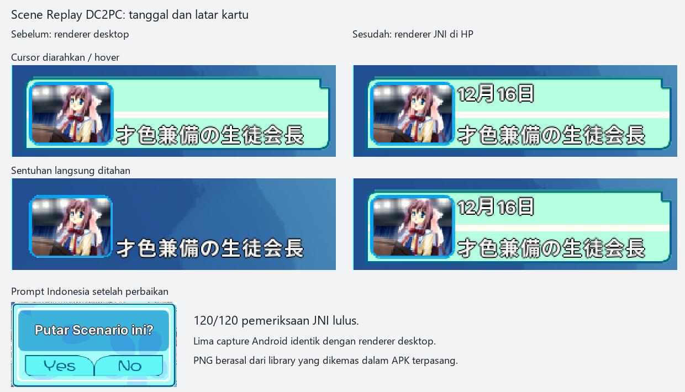
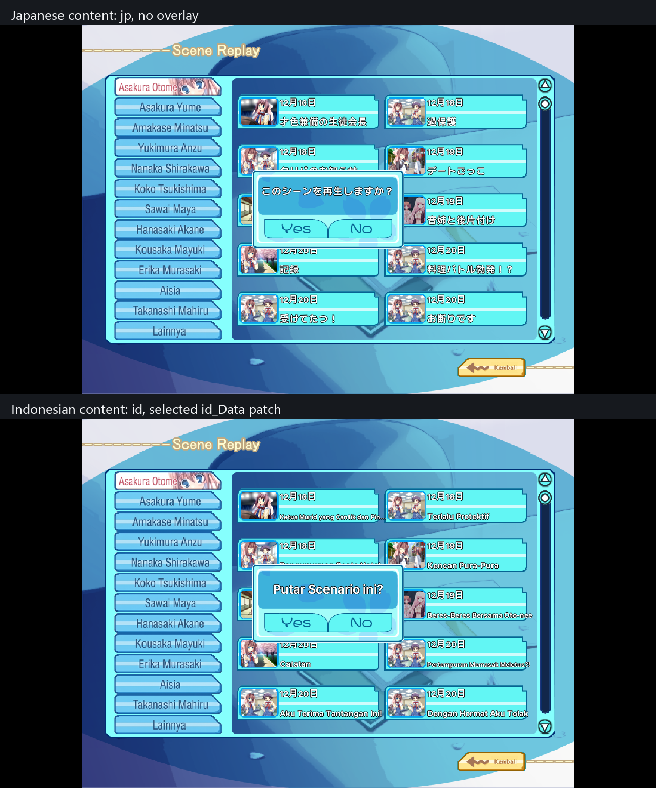

# Perbaikan Scene Replay DC2PC

14 November 2026. Build lokal Arisa32 0.7.2/code20 sudah dipasang ke HP I2219 dengan `adb install -r`. Tanggal tetap terlihat saat hover dan ditekan; kartu yang ditekan mempertahankan warna hijau muda dari artwork hover PC. Prompt Indonesia berubah menjadi **Putar Scenario ini?**.

## Penyebab dan perubahan

- Caption tanggal sebelumnya memakai state 99, sehingga hanya digambar saat kartu normal. Caption sekarang memakai state -1, yang tetap digambar dalam semua keadaan input.
- Kartu Scene sebelumnya meminta state 2 saat ditekan, tetapi aset katalog menyediakan normal dan hover. Renderer memakai state 1 selama kartu ditahan, seperti jalur Music yang sudah diperbaiki.
- Perubahan kartu dibatasi ke katalog DC2PC; DC2TY mempertahankan jalurnya sendiri. Teks prompt merupakan terjemahan bersama `ConfirmKind::SceneReplay`, sehingga perubahan katanya berlaku pada dialog tersebut di profil lain juga.

Kode: `core/src/system_menu.cpp` dan `core/src/confirm_dialog.cpp`. Perubahan Music yang sudah ada tetap disertakan dalam APK ini.

Analisis [seluruh 2.032 frame video sumber](dc2pc-scene-replay-analysis.md) menemukan 264 frame Arisa32 dengan tanggal hilang, termasuk 79 frame tanpa latar kartu. Video PC mempertahankan tanggal pada seluruh 249 frame menu yang terlihat penuh. Pengukuran memakai PTS asli, mengecualikan fade dan bagian yang tertutup dialog, serta memeriksa setiap batas kejadian secara visual.

## Verifikasi



- **CTest: 6/6 lulus**, total 93,06 detik: `dc2pc_menu_test`, `dc2ty_menu_test`, `dc2dm_menu_test`, `system_menu_test`, `text_render_test`, `confirm_dialog_test`.
- Tes Scene memeriksa 10 kartu dengan MS Gothic dan Pretendard JP: normal, hover, tahan dengan cursor, pointer keluar, sentuhan langsung, konfirmasi dan pembatalan. Piksel inti tanggal harus tetap sama; hasil tekan harus identik dengan hover.
- **Android JNI: 120/120 pemeriksaan lulus** pada perangkat I2219, memakai library arm64 yang diekstrak dari APK baru. Lima capture 1280x720 (normal, hover, cursor ditahan, sentuhan ditahan, prompt Indonesia) identik dengan renderer desktop: nol piksel berbeda.
- **Pilihan konten: 36/36 pemeriksaan tambahan lulus** memakai data asli Jepang dan patch `id_Data` yang benar-benar ada di HP. Prompt Jepang adalah `このシーンを再生しますか？`; prompt patch Indonesia adalah `Putar Scenario ini?`. Kedua dialog cocok dengan render teks referensi: nol piksel berbeda. Pemeriksaan 120 poin sebelumnya memakai aset dasar dengan bahasa dipaksa ke `id`; pengujian tambahan ini memastikan overlay patch yang sesungguhnya juga bekerja.
- Probe Android berjalan melalui `app_process` dengan data uji terpisah. Tidak membuka Activity atau menyuntikkan sentuhan ke layar HP. Ini memverifikasi renderer dan jalur input native; bukan pengujian ulang gesture fisik pada Activity Android.
- DC2PC dan DC2TY memakai aset game lokal. DC2DM memakai fixture; pengujian aset DC4 pada `system_menu_test` dilewati karena `DC4_TEST_DATA` tidak disetel.
- Build `assembleDebug` berhasil untuk `arm64-v8a` dan `armeabi-v7a`. Runtime JNI diuji pada arm64; `git diff --check` lulus.

Perintah desktop:

```powershell
$env:DC2PC_TEST_DATA='E:/Games/DC2PC/AdvData'
$env:DC2TY_DATA='E:/Games/DC2TY/AdvData'
ctest --test-dir build/desktop -R '^(dc2pc_menu_test|dc2ty_menu_test|dc2dm_menu_test|system_menu_test|text_render_test|confirm_dialog_test)$' --output-on-failure --parallel 2
```

## Bahasa prompt mengikuti konten game

Bahasa antarmuka Arisa32 terpisah dari bahasa konten game. `GameLibrary.Entry.overlay()` memilih patch berdasarkan `selected.language`; `Arisa32Activity.startRendering()` mengirim overlay dan bahasa itu ke JNI. `SystemMenu` memakai bahasa konten tersebut ketika membuka dialog. Tanpa patch terpilih, konten `jp` memakai teks Jepang. Ketika memilih patch Indonesia (`id_Data`, bahasa `id`), dialog memakai **Putar Scenario ini?**. Tidak diperlukan perubahan tambahan pada pemilihan bahasa.



Uji kedua konten berjalan terpisah di latar belakang dengan APK yang sama. Aplikasi yang sedang tampil di HP tetap sama sebelum dan sesudah pengujian; data game pengguna tidak diubah.

## APK dan data pengguna

APK: `android/app/build/outputs/apk/debug/app-debug.apk`. Pembaruan terpasang berhasil; SHA256 `base.apk` di HP identik dengan APK lokal:

```text
4f8ccc299e36e901c65d47433fa0106452dca7ce4f3e06e0678feb848bcdd33b
```

Hash lima berkas di `files` dan `shared_prefs` aplikasi sama sebelum dan sesudah pemasangan. Pemasangan tidak menghapus data. Probe hanya menautkan GRP/MES/DAT secara baca-saja dan menyimpan data uji di direktori tersendiri; direktori probe di HP sudah dihapus setelah bukti diambil. Build ini belum dipublikasikan sebagai rilis GitHub.

## Pemeriksaan dalam lingkup perubahan

Arah mengikuti Scene Replay PC yang diminta: ENERGY 2 / RHYTHM 2 / MOTION 1. Susunan dua kolom, warna sian/hijau muda, thumbnail, tanggal dan sorotan berasal dari game asli.

- **Hard Gate PASS, lingkup perubahan:** tanggal tetap ada pada semua keadaan yang diuji; prompt tampil utuh; build, enam tes dan 120 pemeriksaan JNI berhasil. Tidak ada kontrol atau artwork baru.
- **Purpose Gate PASS:** tanggal mengidentifikasi scenario; hijau muda menunjukkan kartu yang diarahkan atau ditekan, mengikuti PC.
- **Liveliness PASS, lingkup perubahan:** komposisi, motif dan umpan balik memakai arah visual PC yang sudah ditentukan pengguna; tidak menambah animasi.
- **Craftsmanship PASS, lingkup perubahan:** bukti sebelum/sesudah, pembatalan, kedua font dan regresi profil terkait sudah diperiksa. Ini bukan audit aksesibilitas atau seluruh alur aplikasi.

Hanya laporan dan tiga gambar bukti terpilih disimpan di `docs/`. Frame, capture perantara, CSV metrik dan log tetap di Temp tugas.
