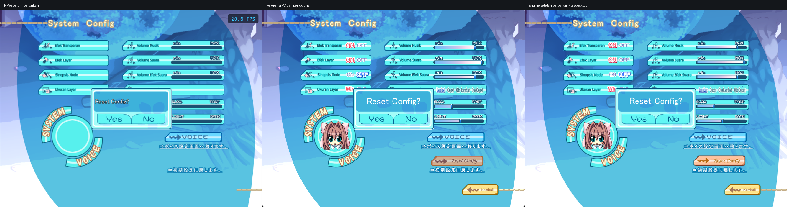

# DC2TY: popup Reset Config

10 November 2026. Arah visual mengikuti screenshot PC pengguna: grafik Config tetap terlihat, panel konfirmasi berada di tengah, dan judul putih berada di tengah panel. Dial untuk perbaikan ini: ENERGY 2 / RHYTHM 1 / MOTION 1, mengikuti artwork dan interaksi game.



Panel kanan adalah pengujian desktop memakai renderer portable yang juga dipakai Android, bukan screenshot HP setelah instalasi. Capture memakai MS PGothic untuk bahasa Latin; PC menggunakan Arial dari patch terjemahannya, sehingga bentuk dan lebar huruf tidak identik.

## Penyebab dan perubahan

- `option.mes` menjalankan `raw21 0,0` sebelum menggambar panel reset, tanpa menggambar ulang background. Native menghapus target interaksi sambil mempertahankan piksel. Engine ikut menghapus chip yang terkait kontrol, sehingga ikon, ON/OFF, slider, Reset Config, dan Back hilang.
- Pada Config dengan layout native DC2PC/DC2TY, chip kini diselesaikan sesuai nilai slider/status sebelum target interaksi dilepas. Background Config baru membersihkan chip dan caption lama. Retensi tidak diterapkan ke Music atau Replay yang memiliki siklus gambar berbeda.
- Tombol Yes menjalankan label native `init`, tanpa konfirmasi generik kedua. No dan Back menjalankan `menu`; slider di belakang popup tidak menerima input.
- `raw60` menyimpan jarak antarbaris pada kata ketiga, bukan ukuran glyph. Reset DC2TY memakai glyph 28px, palette 7 putih tanpa shadow, serta baseline native 24px untuk teks Jepang.
- Untuk teks `Reset Config?` yang dinormalisasi dari ASCII/fullwidth pada posisi reset yang dikenali, engine mengikuti patch PC: mencari ukuran 28 sampai 18px yang muat dalam 216×28, lalu memusatkan batas tinta pada koordinat game `(400,278)`. Jika tidak ada ukuran yang muat, renderer kembali ke posisi native. Teks Jepang tetap memakai posisi script.
- Opsi tanpa outline pada `FontRenderer` hanya digunakan oleh caption reset ini; nilai default mempertahankan perilaku pemanggil lain.

## Sumber

- HP: screenshot ADB `phone-before.png` di direktori sementara tugas, sebelum perubahan. Tidak ada tap atau reset pengaturan pada HP selama verifikasi.
- PC: `C:/Users/adamb/AppData/Local/Temp/codex-clipboard-2921815e-76cc-4a39-9d6a-26670c8c950d.png`.
- `E:/Games/DC2TY/AdvData/MES/option.mes`: label `initConfig` offset 4144, clear layout 4159, panel 4177, caption 4186, label Yes `init` dan No `menu`.
- `E:/Games/DC2TY/id_Data/MES/option.mes`: caption `Reset　Config?` dengan koordinat script yang sama.
- `E:/Games/DC2TY/DC2TYMesTextTool_GUI-and-Patch/DC2TYPatch a/src/dc2typatch.cpp`: `ReadSystemPopupLabel`, `BuildSystemPopupBitmap`, `DrawSystemPopupBitmap`, dan `Hook_SystemLabel_24240`. Log native mencatat bitmap Arial 164×24 untuk caption ini.

## Verifikasi

| Pemeriksaan | Hasil |
| --- | --- |
| DC2TY dengan aset asli | PASS: tiga siklus popup; piksel di luar panel identik; hanya dua kontrol aktif; slider terblokir; No/Back memulihkan frame dan nilai; Yes menjalankan default native; pengaturan Voice yang tidak direset tetap utuh |
| Overlay terjemahan | PASS: file MES overlay benar-benar dimuat; judul putih pada bbox output `(545,320)..(735,346)`, pusat `(640,333)` pada kanvas 1280×720; pembatalan memulihkan frame |
| Tanpa outline | PASS: glyph putih pada alpha transparan; mode default tetap memiliki outline gelap |
| Regresi | PASS 6/6: text render, DC2PC dengan aset asli, DC2DM MS Gothic, DC2DM Pretendard, dialog konfirmasi, dan menu generik |
| Build | PASS: desktop, APK arm64-v8a dan armeabi-v7a |
| Instalasi | PASS: `adb install -r` pada iQOO Z9x, versi 0.7.1 / code 19; update perangkat 10 November 2026 pukul 15.31.03 Asia/Bangkok |
| Paket terpasang | PASS: SHA256 `base.apk` di HP identik dengan hasil build lokal |
| Whitespace | PASS: `git diff --check`; hanya pemberitahuan normalisasi CRLF |

APK berukuran 19.503.036 byte. SHA256:

```text
e93ff21bfaf98bcec1c50af8682ad1a80fce986175b280e16d19255c81d35efa
```

Instalasi memakai pembaruan, tanpa menghapus data aplikasi. Tampilan pascainstalasi belum diklik langsung di HP. Pengujian reset berjalan pada instance desktop terisolasi dari save pengguna.

## Antislop during: delivery gate untuk perbaikan ini

- Hard Gate PASS dalam cakupan kompatibilitas: build dan klik Yes/No/Back diuji; judul berada di dalam panel; aset asli dan tampilan PC yang diminta dipertahankan. Ini bukan audit aksesibilitas seluruh game; warna artwork mengikuti referensi pengguna.
- Purpose Gate PASS: retensi grafik menjaga konteks pengaturan, sedangkan ukuran dan pemusatan judul mengikuti fungsi patch PC yang diperiksa. Tidak ada dekorasi atau navigasi baru.
- Liveliness PASS: dials mengikuti Config asli; popup tetap menjadi fokus, dengan motif, warna, ikon, dan jarak dari artwork game.
- Craftsmanship PASS: piksel, nilai pengaturan, siklus berulang, bahasa terjemahan, renderer, dan regresi profil lain diuji. Perbedaan font PC serta batas verifikasi HP dinyatakan di atas; komentar baru menjelaskan format atau koordinat native.
