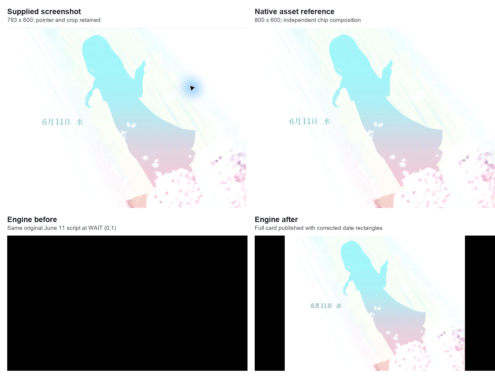
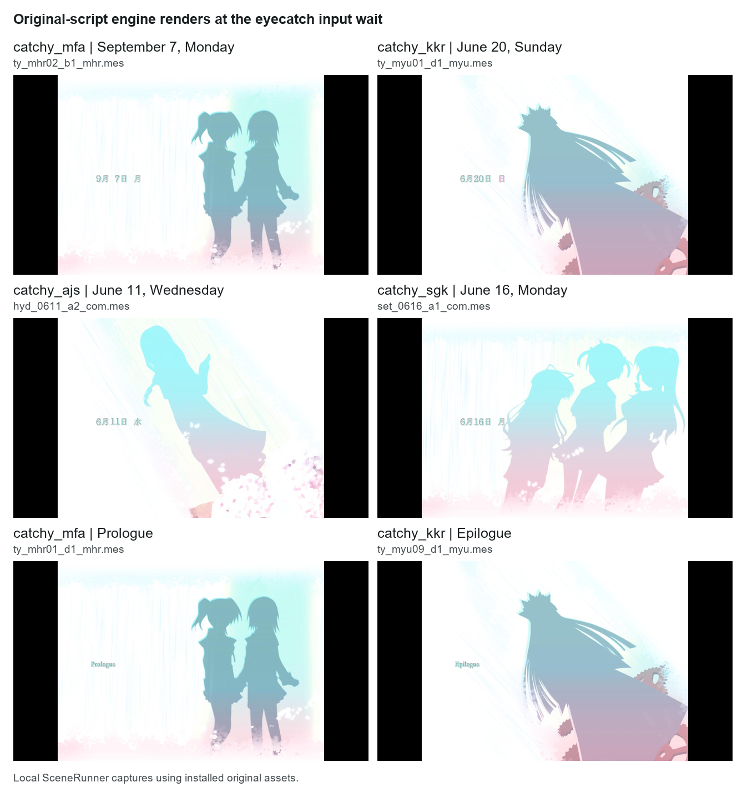

# DC2TY date-change eyecatch

DC2TY now presents the complete date-change card at its authored input wait. The supplied June 11 screenshot uses the original `system\catchy_ajs` background and five pieces from `system\catchy_chip`. The baseline engine selected these pieces but displayed a black frame. The fix publishes pending drawing at the wait and interprets the scene-chip source endpoints correctly.

The original June 11 scene, all four artwork variants, and the Prologue/Epilogue labels pass local engine checks. The comparison below distinguishes the supplied screenshot, an independent composition of original assets, and this engine's before/after renders.



## Original assets and script selection

The four backgrounds are 800 × 600 CRX images. The date atlas is 512 × 96. All five installed files use compression 2, 24-bit color and mode 0. The original artwork supplies the white background, pastel cyan and pink silhouettes, and date typography.

| `8[4]` | Background | Scripts containing an eyecatch | Representative original script | Date variables `8[13]`, `8[12]`, `8[14]` |
| --- | --- | --- | --- | --- |
| 0 | `system\catchy_mfa` | 24 | `ty_mhr02_b1_mhr.mes` | `9, 7, 0`: September 7, Monday |
| 1 | `system\catchy_kkr` | 9 | `ty_myu01_d1_myu.mes` | `6, 20, 6`: June 20, Sunday |
| 2 | `system\catchy_ajs` | 24 | `hyd_0611_a2_com.mes` | `6, 11, 2`: June 11, Wednesday |
| 3 | `system\catchy_sgk` | 7 | `set_0616_a1_com.mes` | `6, 16, 0`: June 16, Monday |

The scan found `catchy_` assets referenced in 64 of the 153 installed scripts. The table groups them by their first assignment to `8[4]`. Weekday values run from Monday `0` through Sunday `6`. The atlas also contains Prologue and Epilogue labels; `ty_mhr01_d1_mhr.mes` sets `3[40] = 1`, and `ty_myu09_d1_myu.mes` sets `3[40] = 2`.

Fresh CRX decoding reproduces all four existing extracted background PNGs pixel for pixel. The atlas's visible pixels also match. The earlier extracted atlas retains 35,738 opaque magenta color-key pixels; the current decoder makes those pixels transparent. This difference is expected.

The installed `id_Data/MES/hyd_0611_a2_com.mes` overlay has the same date block, offsets and geometry as `AdvData/MES/hyd_0611_a2_com.mes`. No additional `catchy` or `eyecatch` asset filenames were found in `id_Data`.

## June 11 script path

Offsets are relative to the script code, including its two-byte version. `hyd_0611_a2_com.mes` assigns `8[4] = 2` at offset 173, month `6` at 182, day `11` at 191, and weekday `2` at 200.

| Offset | Original command | Role |
| --- | --- | --- |
| 209 | raw `30`, `bg\black` | Stage black |
| 219 | raw `31`, slot `6`, `system\catchy_chip` | Load the date atlas |
| 239 | raw `0D (0,0)` | Present black |
| 242 | raw `12 (5,0)` | Authored entry wait |
| 3787 | raw `30`, `system\catchy_ajs` | Load the selected full-screen background |
| 3995 through 5390 | Five raw `53`/`52` pairs | Draw `6月11日 水` |
| 7371 | Set `3[40] = 0` | Clear the special-label selector |
| 7380 | raw `12 (0,1)` | Hold the completed card for input |
| 7383 | raw `30`, `bg\white` | Continue to white after input |
| 7393 | raw `0D (0,0)` | Present white |
| 7396 | raw `30`, `bg\bg174_d_no` | Stage the next scene |

There is no raw `0D` between drawing the date card and its input wait. A renderer that only publishes through raw `0D` therefore keeps the preceding black frame visible throughout this wait.

The native raw `12` handler starts at `0x41DF21`. Its flag-4 arm-only branch at `0x41DF87` through `0x41DFA3` exits before publication. Other waits test authored drawing flag `0xAAFC70` at `0x41DFB6` and, when set, call `0x41C920` followed by `0x40D650`. `0x41C920` composes through `0x41C360` when required, then presents through `0x41C880`. Raw `30` sets the drawing flag at `0x41F4DE`; raw `53` sets it at `0x41F820`. Native VM batch entry at `0x41DAE0` resets it.

The original handler stores an ordinary zero wait count as `-1` at `0x41DFAC`, so the date card's zero-count wait has no timer expiry. The reference-wait path at `0x424753` advances the prior target cadence at `0x424780`; adding publication must preserve that armed-wait timing.

## Native chip geometry

Analysis used the installed `DC2TY.exe`, SHA256 `21988CA3227D494AD8FD816FD6363670B1A6245F82AC28314C4BB4E8353D19BD`. Addresses below are executable virtual addresses.

The native raw `53` handler at `0x41F682` consumes the following raw `52`. Raw `53` supplies destination X/Y and source left/top. For the normal bitmap path, the first two raw `52` words are source right/bottom:

```text
width  = raw52[0] - source_left
height = raw52[1] - source_top
```

The subtraction instructions are `0x41F79F` (`sub edx, ebp`) and `0x41F7C9` (`sub eax, ebx`); the engine stores their results at `0xAD519C` and `0xAD51A0`. The word reader at `0x41B840` reads signed little-endian 16-bit operands. The draw path at `0x41C56F` clips to destination plus the computed width/height and draws from destination minus source origin.

The sheet/control operand is read at `0x41F6F4`. Bit `0x40`, tested at `0x41F714`, selects a separate path that stores the first two words directly as width and height at `0x41F725` and `0x41F756`. The fix must preserve that direct-size case. The ordinary eyecatch pairs all use sheet `6`, so they take the endpoint path.

A static scan found 13,440 raw `53`/`52` alternatives in the 64 eyecatch blocks: 13,312 date pieces and 128 special-label pieces. Every pair uses sheet/control `6` and state `1`; none sets bit `0x40`. These counts include unselected script alternatives. The only raw `53`/`52` pair elsewhere with that bit set is `start.mes` at offsets 2605/2614, with destination/source `(0, 0, 0, 0)` and raw `52 (800, 600, 192, 1)`. Its control value is `0xC0`.

| Piece | Raw `53` / `52` offsets | Destination | Source `(left, top, right, bottom)` | Width × height |
| --- | --- | --- | --- | --- |
| `6` | 3995 / 4004 | `(100, 300)` | `(160, 0, 192, 24)` | 32 × 24 |
| `月` | 4226 / 4235 | `(132, 300)` | `(0, 48, 24, 72)` | 24 × 24 |
| `11` | 4589 / 4598 | `(156, 300)` | `(320, 0, 352, 24)` | 32 × 24 |
| `日` | 5282 / 5291 | `(188, 300)` | `(24, 48, 48, 72)` | 24 × 24 |
| `水` | 5381 / 5390 | `(228, 300)` | `(48, 72, 72, 96)` | 24 × 24 |

The previous implementation used `192 × 24` for the month and `72 × 96` for Wednesday, for example. Publishing that composition without fixing its geometry would reveal adjacent atlas pieces.

Prologue uses source `(432, 48, 512, 72)` and Epilogue uses `(432, 72, 512, 96)`, both at destination `(100, 300)`. Both labels should therefore be 80 × 24.

## Fix boundary

The TY scene path records new authored background and scene-chip drawing separately from ordinary render dirtiness. An eligible wait with pending drawing composes the scene, immediately publishes its frame, clears the previous black/pending hold, and consumes that authored drawing state. A wait without new authored drawing preserves the existing displayed frame. The flag-4 arm-only path still returns before publication; later armed waits keep their existing timing. Transition starts consume their pending drawing so a following unchanged wait retains the transition's endpoint.

The geometry change applies to TY scene-chip pairs. It subtracts the source origin from the raw `52` endpoints for non-button chips when bit `0x40` is clear. Button-chip dimensions, direct-size operands, DC2PC and DC2DM keep their existing behavior.

## Native reference and comparison criteria

An independent reference composition uses the freshly decoded `catchy_ajs` image and the five explicit rectangles above. It applies the atlas color key and copies each piece onto the native 800 × 600 background. The reference is derived from the original assets and recovered geometry; it is not a capture from either the original executable or this engine.

The supplied screenshot is 793 × 600; the independent reference is 800 × 600. Comparing screenshot crop `(0, 2, 793, 600)` with reference crop `(2, 0, 795, 598)` requires only a two-pixel translation and no resizing. After excluding the pointer/glow rectangle `(545, 130, 675, 275)` in the comparison image, all 455,364 tested pixels match exactly. This verifies both the selected artwork and date composition. The complete files differ at the pointer, image edges and crop.

The engine scales the 800 × 600 classic background into a centered 960 × 720 viewport in a 1280 × 720 frame. Its existing pixel-centered bilinear sampler scales and positions each chip separately. A whole native composition enlarged with Pillow's nearest-neighbor sampler therefore has different edge pixels and integer rounding. This fix does not change that scaling path.

The June 11 engine render differs from that nearest-neighbor comparison at 116,963 pixels. The background mean absolute channel difference is 0.176 on the 0-to-255 scale; glyph edges account for the larger local differences below. These measurements compare two different sampling methods and do not establish pixel identity with native runtime output.

| Comparison region | Pixels | Mean absolute channel difference | Maximum | Pixels over 3 in any channel | Pixels over 10 in any channel |
| --- | --- | --- | --- | --- | --- |
| Date area `(280, 360, 463, 389)` | 5,307 | 12.083 | 134 | 2,096 | 1,762 |
| Remaining centered viewport | 685,893 | 0.176 | 41 | 10,110 | 1,298 |

The original-script probe must load `start.mes` sheets and UI before advancing the selected scene. It must stop on the eyecatch's raw `12 (0,1)` rather than skipping waits to the next dialogue. The existing SDL `--shot` dialogue path skips waits, so it cannot establish whether this intermediate frame appears.

The maintained `dc2ty_eyecatch_test` covers publication at the input wait, endpoint-sized glyphs, transparent atlas pixels, clearing date pieces on the next background, unchanged displayed frames, fresh black scenes, transition black holds, armed waits, disabled effects, button-chip isolation and the classic-profile boundary. The original-script path checks the expected selected chip count, a complete visible viewport, an unchanged frame and script position after 60 seconds, then wait release and progression after input.

Reproduce the maintained regression and six original-script captures from the repository root:

```powershell
cmake --build build/desktop --target dc2ty_eyecatch_test
build/desktop/dc2ty_eyecatch_test.exe
build/desktop/dc2ty_eyecatch_test.exe E:/Games/DC2TY/AdvData "$env:TEMP/arisa32-dc2ty-eyecatch"
```

An optional third argument selects one script, for example `hyd_0611_a2_com.mes`. The test writes temporary PPM frames before advancing the eyecatch wait.

## Verification on 2026-11-10

The original June 11 baseline capture is 1280 × 720 and contains exactly one RGB color, `(0, 0, 0)`, across all 921,600 pixels. The probe reports five selected date chips at the input wait. This establishes the missing publication independently of the endpoint-size error.

The fixed original-script run completed all six cases with zero failures in 5.60 seconds. Each captured frame has exactly 691,200 nonblack pixels, matching the centered 960 × 720 viewport. Visual inspection confirmed each selected background, all four dates, and the Prologue/Epilogue labels without adjacent atlas pieces. Each card remained unchanged through the 60-second wait check and advanced after input. The original-script continuation test checks that the next frame differs; the synthetic test separately verifies that a former weekday pixel becomes the new background color.



The desktop Release build succeeded. Selected CTest execution passed all six targets in 83.55 seconds: `dc2ty_eyecatch_test`, `dc2ty_transition_test`, `dc2pc_flow_test`, `dc2dm_transition_test`, `dc2dm_sprite_test`, and `mesvm_test`.

These captures run `SceneRunner` locally with installed original scripts and artwork. The supplied screenshot is the only external visual reference used here. This work did not access a phone, run a GUI or capture the original executable. Native runtime timing and scaled output have not been compared through a new PC/device recording.

The final Android `assembleDebug` build succeeded in 3 minutes 7 seconds for `arm64-v8a` and `armeabi-v7a`, including this eyecatch fix and the earlier sprite, transition and replay changes. The output is `android/app/build/outputs/apk/debug/app-debug.apk`, version 0.7.1, version code 19, 19,533,320 bytes, written on 2026-11-10 at 22:21:59 Bangkok time. `apksigner verify --verbose` passed v1 and v2 signature checks. APK SHA256: `D1410421216C3AA7D883F23D3ABF51804C8CC4E944ABC9CAA5E734B49D1DA38A`. Build verification used local files only.

After the user explicitly requested installation, `adb install -r` succeeded on the connected I2219 phone. Package metadata confirmed version 0.7.1, code 19, and update time 2026-11-10 22:31:17 Bangkok time. This installation did not launch the app or capture the screen; on-device visual verification remains pending.

## Delivery gate

- Hard gate PASS: the desktop renderer was built and run, all six original cards were inspected, and every image labels its source. The restored card uses existing artwork and adds no controls or fabricated content.
- Purpose gate PASS: publication follows native wait behavior, and date rectangles follow the executable's endpoint subtraction. The evidence records exact script offsets, source rectangles and comparison limits.
- Liveliness PASS: the original white canvas, cyan/pink silhouettes, date typography and composition are preserved. The existing date and silhouette remain the card's focal elements; this fix adds no visual style or animation.
- Craftsmanship PASS: all 153 scripts were scanned for eyecatch operands, six regression targets pass, and the six original-script cases preserve their input wait and continuation. Copy and evidence captions state measured results without claiming device validation or scaled pixel identity.
