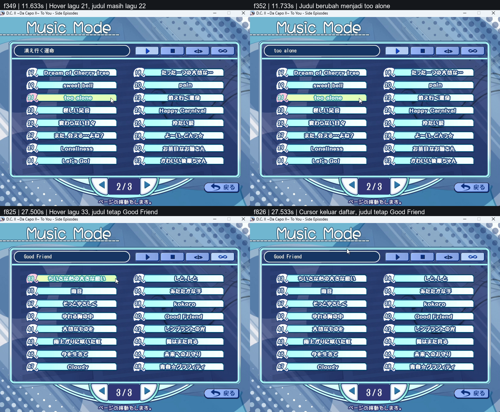

# DC2TY Music Mode: analisis rekaman PC

Tindak lanjut: [implementasi, pengujian, dan screenshot APK di HP](dc2ty-music-mode-fix.md). Bagian perbedaan engine di bawah mencatat keadaan sebelum perbaikan.

Sumber: `C:/Users/adamb/AppData/Local/Packages/Microsoft.ScreenSketch_8wekyb3d8bbwe/TempState/Recordings/20261110-0819-08.4967772.mp4`.

Rekaman 794×622, 30 fps, durasi 29,466633 detik, berisi 884 frame. Nomor frame dalam laporan dimulai dari 0; frame terakhir 883 pada 29,433333 detik. Semua frame didekode, dibandingkan antarframe, dan diperiksa melalui lembar frame berurutan serta pembesaran peristiwa. Frame yang tidak berubah tetap masuk pemeriksaan.

## Arti kotak dan sorotan

Kotak memanjang berbingkai putih di kiri atas menampilkan judul lagu yang sudah dipilih. Teks ini bertahan ketika cursor berpindah ke lagu lain, keluar dari daftar, atau halaman daftar berubah.

Warna hijau muda pada baris daftar adalah hover cursor. Sorotan tersebut tidak menjadi penanda permanen lagu yang terpilih atau sedang diputar. Hover dan tombol yang sedang ditekan memakai artwork baris yang sama, sehingga warna hijau saja tidak membuktikan klik; perubahan judul atas memberi bukti aktivasi yang lebih jelas.

Contoh yang paling jelas:

- Frame 349 / 11,633 detik: baris 21 `too alone` sudah hijau, tetapi kotak atas masih menampilkan lagu 22 `消え行く運命`.
- Frame 352 / 11,733 detik: kotak atas berubah menjadi `too alone`, setelah aktivasi pilihan.
- Frame 825 / 27,500 detik: cursor menyorot baris 33, tetapi kotak atas tetap `Good Friend` dari baris 40.
- Frame 826 / 27,533 detik: cursor keluar dari daftar, sorotan baris hilang, sedangkan `Good Friend` tetap terlihat sampai akhir rekaman.

Daftar terdiri dari 48 lagu, 16 per halaman, disusun dua kolom dengan nomor ganjil di kiri dan genap di kanan. Panah bawah berpindah halaman. Kotak judul tetap mengingat pilihan yang tidak sedang terlihat pada halaman tersebut.

## Peristiwa terukur

Ada 17 perubahan judul setelah frame awal. Batas perubahan di bawah diverifikasi pada perbandingan frame asli, dengan minimal 486 piksel judul berubah pada setiap aktivasi. Perubahan kecil ketika cursor melewati kotak judul di akhir rekaman tidak dihitung sebagai pilihan baru.

| Frame / waktu | Perubahan yang terlihat |
| --- | --- |
| 0 / 0,000 s | Halaman 1/3; judul lagu 3 sudah terpilih sebelum rekaman dimulai |
| 7 / 0,233 s | Hover berpindah ke lagu 5; judul sebelumnya masih terlihat |
| 15 / 0,500 s | Kotak judul berubah ke lagu 5 |
| 44 / 1,467 s | Hover lagu 7; judul masih lagu 5 |
| 56 / 1,867 s | Judul berubah ke lagu 7 |
| 73 / 2,433 s | Judul berubah ke lagu 6 |
| 98 / 3,267 s | Judul berubah ke lagu 8 |
| 113 / 3,767 s | Judul berubah ke lagu 10 |
| 178 / 5,933 s | Judul berubah ke lagu 2 |
| 199 / 6,633 s | Judul berubah ke lagu 12 |
| 224 / 7,467 s | Judul berubah ke lagu 14 |
| 249 / 8,300 s | Judul berubah ke lagu 13 |
| 265 / 8,833 s | Judul berubah ke lagu 15 |
| 290 / 9,667 s | Halaman 1/3 menjadi 2/3; pilihan lagu 15 tetap di kotak atas |
| 317 / 10,567 s | Judul berubah ke lagu 26 |
| 339 / 11,300 s | Judul berubah ke lagu 22 |
| 349 / 11,633 s | Hover lagu 21; judul masih lagu 22 |
| 352 / 11,733 s | Judul berubah ke lagu 21, `too alone` |
| 379 / 12,633 s | Judul berubah ke lagu 27 |
| 417 / 13,900 s | Judul berubah ke lagu 20, `pain` |
| 423 / 14,100 s | Cursor berada di area Stop; judul tetap `pain` |
| 425–621 / 14,167–20,700 s | Cursor/keadaan visual tombol Play, Stop, Repeat, dan All berganti; kotak judul tetap `pain` |
| 644 / 21,467 s | Halaman 2/3 menjadi 3/3; judul tidak berubah |
| 669 / 22,300 s | Judul berubah ke lagu 42, `レンブラントの光` |
| 685 / 22,833 s | Judul berubah ke lagu 40, `Good Friend` |
| 729 / 24,300 s | Tampilan kontrol mode berubah ke Repeat |
| 804 / 26,800 s | Tampilan kontrol mode berubah ke All |
| 825–883 / 27,500–29,433 s | Hover berubah/lalu hilang; judul tetap `Good Friend` |

## Pencocokan dengan game native

Pemeriksaan `E:/Games/DC2TY/AdvData/MES/music.mes` dan executable menjelaskan perilaku pada rekaman:

- Baris memakai persegi panjang 296×32 pada x80/x420 dan y160 + 40×baris. Atlas x0 adalah normal; x296 adalah hover/pressed. Script tidak memuat kondisi sorotan baris permanen berdasarkan lagu aktif.
- Judul bukan gambar kolom atlas. Fungsi native `0x40A470` membaca indeks pilihan bank 3[5] dan tabel judul CP932 di `0x4FEB98`, dengan stride 260 byte.
- Judul putih digambar pada `(80,98)` dengan shadow `(81,99)`, dan dipotong ke area `(56,98)..(428,116)` pada kanvas game 800×600. Ukuran font Music adalah 16px ketika 3[31] aktif.
- Halaman memakai 3[8], pilihan lagu 3[5], mode 3[6] dengan nilai 0 normal / 1 repeat / 3 all-play, dan status UI putar/stop 3[7]. Stop mempertahankan judul pilihan.
- ID BGM mengikuti pemetaan script: tiga pilihan awal memetakan ke ID 1, 3, dan 9, bukan langsung nomor baris.

## Perbedaan engine saat analisis

1. Kotak atas sudah ada dalam artwork, tetapi renderer judul khusus DC2TY belum diterapkan. Capture pengujian desktop saat ini memperlihatkan kotak kosong.
2. Intersepsi Music bersama DC2PC menangani `next` sebagai perubahan lagu/all-play. Script DC2TY memakai `next` dan `back` untuk perpindahan halaman. Ini menyebabkan benturan perilaku.
3. Pembukaan halaman langsung ke label `menu` melewati inisialisasi native 3[31], 3[7], 3[6], 3[5], 3[25], dan 3[8]. Pilihan native 3[5] juga dapat tertimpa status `music_selected` bersama.
4. Event lagu selesai pada frontend Android dan desktop masih memanggil `activate("next")`. Setelah tombol Next mengikuti halaman DC2TY, event audio selesai memerlukan jalur tersendiri. Native all-play menggunakan 99[250], menambah pilihan, lalu berputar dari indeks 47 ke 0; flag selesai perlu dikonsumsi agar interpreter tidak terus melompat dalam satu eksekusi.

Perbaikan yang diperlukan ialah inisialisasi Music khusus DC2TY, dispatch label baris/halaman sesuai script, renderer judul, dan pemisahan event akhir audio dari tombol halaman. Artwork hover yang ada tetap sesuai referensi. Analisis ini belum mengubah source Music Mode; APK yang dipasang pada sesi ini berisi perbaikan popup Reset Config.

## Batas bukti

Stream AAC stereo 48 kHz ada di file, tetapi seluruh hasil decode berisi nol: 2.826.240 sampel skalar, peak 0, tanpa satu sampel nonzero. Jadi rekaman ini membuktikan perubahan visual, bukan keluaran suara. Pemetaan BGM dan aturan Stop berasal dari script/executable yang diperiksa.

Rekaman tidak membuktikan satu lagu mencapai akhir, pengulangan lagu penuh, perpindahan otomatis All setelah lagu selesai, atau wrap dari lagu terakhir ke pertama. Perilaku itu memerlukan pengujian terpisah ketika perbaikan Music diimplementasikan.
