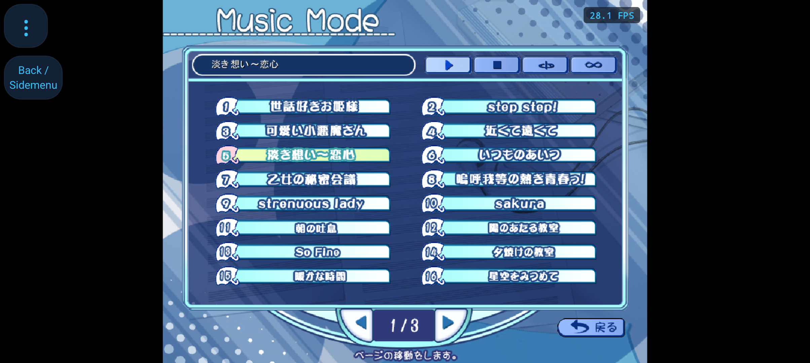

# DC2TY Music Mode: judul pilihan dan kontrol native

Kotak biru di atas daftar kini menampilkan judul lagu yang dipilih. Judul bertahan ketika cursor menyorot baris lain, halaman berubah, atau Stop ditekan. Sorotan hijau tetap mengikuti hover sesuai rekaman PC.

## Arah visual

Music Mode mengikuti artwork dan interaksi DC2TY pada rekaman PC, untuk pemain yang memakai sentuhan atau cursor. ENERGY 2 / RHYTHM 2 / MOTION 1: kotak judul menjadi fokus status, daftar dua kolom menjaga ritme, dan gerak terbatas pada respons kontrol. Warna, motif, ikon, dan susunan berasal dari aset game. Tidak ada aset atau navigasi baru.

## Penyebab dan perbaikan

- Artwork memuat kotak judul, tetapi teksnya digambar executable PC. Port sebelumnya belum menggambar teks tersebut. `dc2ty_music.h` menyimpan 48 judul dari tabel CP932 executable di VA `0x4FEB98`, stride 260 byte; semua literal diperiksa terhadap tabel asli.
- Renderer membaca pilihan native `3[5]`, memakai font yang dipilih pengguna pada ukuran native 16px, teks putih dengan shadow satu piksel, dan clip `(56,98)..(428,116)` pada kanvas 800×600. Glyph dirasterisasi pada skala output, tanpa outline tambahan.
- Pembukaan Music menjalankan awal `music.mes`, sehingga pilihan, halaman, mode, dan flag font diinisialisasi sesuai script. Penggambaran ulang tidak mengulang inisialisasi.
- Intersepsi DC2PC tidak lagi menimpa aksi Music DC2TY. Label baris menjalankan pemetaan BGM asli; `next` dan `back` berpindah halaman, termasuk wrap tiga halaman. Halaman memakai `3[8]` dan tidak mengubah pilihan `3[5]`.
- Android dan desktop memakai `music_finished()` untuk event akhir audio. All Play menjalankan `all_play_chk`, maju satu lagu, mempertahankan halaman, dan kembali dari indeks 47 ke 0. BGM baru mengonsumsi `99[250]` agar satu event tidak maju berkali-kali. EOF normal/repeat tidak mengubah flag UI, sesuai script native; Stop yang mengubah `3[7]`.
- Aksi PlayMusic eksplisit pada Android memulai ulang lagu sekaligus menerapkan pilihan loop, termasuk jika aset sama dengan yang sedang diputar.

## Bukti dan batas

Analisis semua 884 frame serta rincian native tersedia di [analisis rekaman](dc2ty-music-mode-analysis.md). Screenshot HP sebelum perubahan menunjukkan hover baris 5 dengan kotak judul kosong. Rekaman PC tidak berisi sampel audio nonzero, sehingga aturan BGM diperiksa dari script dan melalui pengujian, bukan disimpulkan dari suara rekaman.

Pengujian penyelesaian lagu memakai event EOF terkontrol. Itu memverifikasi dispatch All Play tanpa harus menunggu semua 48 lagu diputar sampai selesai.

APK diperbarui dengan `adb install -r` pada iQOO Z9x, 10 November 2026 pukul 16.48.47 Asia/Bangkok, versi 0.7.1 / code 19. SHA256 `base.apk` di HP cocok dengan hasil build lokal: `ca60612c05237867cfc3755cd14e7693d3e7972e5192665d974e9ea0ea7029dd`. Screenshot pascainstalasi di atas memperlihatkan `淡き想い～恋心` di kotak atas. Tidak ada penghapusan data aplikasi atau tap otomatis pada HP selama verifikasi.

## Verifikasi

| Pemeriksaan | Hasil |
| --- | --- |
| DC2TY Music | PASS: semua 48 baris dipilih lewat pointer dan menghasilkan ID/aset BGM sesuai script |
| Judul dan hover | PASS: hover mengubah baris, tetapi piksel judul tetap identik; judul berubah setelah pemilihan lagu |
| Halaman | PASS: Next/Back berputar tiga halaman tanpa mengganti pilihan, mode, status Stop, atau piksel judul |
| Play, Stop, Repeat, All | PASS: mode dan parameter loop mengikuti script; Stop mempertahankan judul; EOF biasa tidak mengubah tampilan |
| All Play EOF | PASS: satu event menghasilkan satu PlayMusic, flag EOF dikonsumsi, halaman tetap, indeks 47 kembali ke 0 |
| Font | PASS: MS Gothic dan Pretendard JP Bold; sampel Latin/Jepang berada pada y119..136, di dalam clip y117..138 |
| Regresi DC2TY | PASS: title, selector, voices, Config/reset, progress, CG pan, dan replay |
| Profil lain | PASS 6/6: DC2PC, DC2DM MS Gothic/Pretendard, menu generik, dialog konfirmasi, dan text render |
| Build | PASS: desktop dan APK arm64-v8a/armeabi-v7a |
| HP | PASS: instalasi update, hash identik, dan screenshot langsung memperlihatkan judul pilihan |

## Antislop during: delivery gate

- Hard Gate PASS: judul putih memiliki kontras 12,12:1 terhadap piksel latar `(21,53,102)`; batas glyph diuji untuk dua font; seluruh pilihan dan kontrol Music diuji. Tidak ada salinan teks promosi, konten rekaan, link, form, tema, atau media baru. Artwork dan input game asli mengikuti referensi pengguna; ini bukan audit aksesibilitas seluruh aplikasi.
- Purpose Gate PASS: font yang dipilih pengguna dipertahankan; clip dan shadow mengikuti renderer PC; pemisahan judul dan hover menyampaikan dua status yang berbeda. Tidak ada dekorasi, ikon, layout, atau animasi tambahan.
- Liveliness PASS: ENERGY 2 / RHYTHM 2 / MOTION 1 mengikuti tampilan asli. Kotak judul, aksen hover, motif biru, jarak baris, dan susunan dua kolom tetap konsisten dengan arah visual di atas.
- Craftsmanship PASS: 48 pemetaan aset, siklus halaman, mode audio, EOF, dua font, regresi profil lain, build, dan instalasi diverifikasi. Screenshot HP adalah hasil APK terpasang; komentar baru menjelaskan sumber tabel dan koordinat native.
