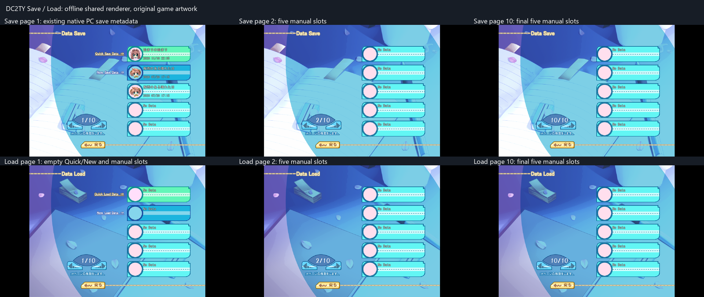

# DC2TY native save reference

Read-only evidence from the installed Japanese `DC2TY.exe` (SHA-256
`21988CA3227D494AD8FD816FD6363670B1A6245F82AC28314C4BB4E8353D19BD`),
its `AdvData/MES/save.mes` and `load.mes`, and existing native save files.
The executable was disassembled; it was not launched against the user's saves.

## File IDs and pages

The format string at virtual address `0x5126EC` is `%s\%s%02d.dat`.
The prefix at `0x5126FC` is lowercase `dc2ty`.

| Native UI location | Physical suffix | Arisa32 logical manual index |
| --- | --- | --- |
| Quick Save | `00` | special slot |
| New Save Data (latest copy) | `01` | special slot |
| Page 1, manual rows 1 to 3 | `02` to `04` | 0 to 2 |
| Page 2 | `08` to `12` | 3 to 7 |
| Page 3 | `16` to `20` | 8 to 12 |
| Page 4 | `24` to `28` | 13 to 17 |
| Page 5 | `32` to `36` | 18 to 22 |
| Page 6 | `40` to `44` | 23 to 27 |
| Page 7 | `48` to `52` | 28 to 32 |
| Page 8 | `56` to `60` | 33 to 37 |
| Page 9 | `64` to `68` | 38 to 42 |
| Page 10 | `72` to `76` | 43 to 47 |

The native row builder at `0x4071D0` computes `page * 8 + visible_row`
with `lea edi,[esi+ebx*8]` at `0x40722F` (Save) and `0x40729B` (Load).
Pages and visible rows are zero-based; rows 0 and 1 are special only on page 0.
There are 48 manual slots, not 30 or 100.

`save.mes` offset 3671 invokes raw `16(4,0)` for the selected manual slot.
Offset 3677 sets variable `99[254]` to 1; offset 3686 invokes the same save
operation again for the latest-copy slot. The quick handler at `0x41FBD0`
through `0x41FBF6` invokes `16(4,1)` and uses physical slot 0.

## Save-screen artwork and geometry

`save.mes` selects `system\save_BG00` at offset 108 for page 0 and
`system\save_BG01` at offset 129 for later pages. `load.mes` selects the
corresponding `load_BG00` and `load_BG01` at offsets 115 and 136.
All four backgrounds decode to 800 by 600 pixels. BG00 includes the authored
Quick Save Data and New Save Data captions; BG01 omits those captions.

Both scripts register five rows with these native rectangles:

| Visible row | Rectangle `(left, top, right, bottom)` |
| --- | --- |
| 0 | `(444, 97, 732, 169)` |
| 1 | `(444, 182, 732, 254)` |
| 2 | `(444, 267, 732, 339)` |
| 3 | `(444, 352, 732, 424)` |
| 4 | `(444, 437, 732, 509)` |

The row atlas is `saveandload_chip00.CRX`, 576 by 288 pixels.
Its normal rows begin at source y 0 (Quick), 72 (New), and 144 (manual).
The hover column begins at source x 288. Later pages use the manual row art
for all five rows. Previous, next, and return hit rectangles are respectively
`(171,437,243,477)`, `(280,437,352,477)`, and `(233,531,345,563)`.

Arisa32 keeps this authored composition, palette, badges, and geometry.
The pagination correction changes which native background and row art appear,
and which logical slot each touch or keyboard action addresses.

The first Save panel reads the existing PC files' title, date, and icon.
The remaining panels show empty slots. These are offline images from the
shared renderer, not captures of the phone or a running native PC game.

## UI validation, 10 November 2026

`dc2ty_menu_test E:/Games/DC2TY/AdvData` passed with exit code 0 after the
shared desktop build. Its focused Save/Load checks cover:

- All 48 logical manual slots agree between row actions and hit testing;
  unused rows and gaps return no action.
- Next wraps page 10 to 1; Previous wraps page 1 to 10; Back returns its action.
- The first and last manual slots on page 10 complete the icon-selection
  flow, returning logical indices 43 and 47 respectively.
- Empty Load rows stay disabled even when Quick/New shortcuts are available.
  Marking a later-page row occupied enables that manual slot. Page 1 retains
  Quick Load and New Load actions.
- Save and Load pages 1, 2, and 10 match 3,726 sampled native-background pixels
  and 30 sampled row-atlas pixels. Later pages use the manual row color.
- The real native-save first page and all six empty-page renders were visually
  inspected. Chapter text, dates, and icons fit their rows; no Quick/New
  caption remains on the later pages.

The same test run also passed the existing title, story selection, voices,
Music, Config/reset, profile, gallery, and scene-replay checks.

Antislop delivery gate, limited to this compatibility correction:

- Hard Gate PASS: tested the listed controls and empty states; preserved the
  requested original artwork; no new navigation or fabricated save contents.
  This is not an accessibility audit of all authored game artwork.
- Purpose Gate PASS: original backgrounds and row colors distinguish the
  first-page special slots from later manual slots and match native file IDs.
- Liveliness PASS: ENERGY 2 / RHYTHM 1 / MOTION 1 follows the supplied native
  menu direction, retaining its page controls, badge motif, and hover state.
- Craftsmanship PASS: tested action mappings and source pixels, built the
  shared renderer, and inspected the saved images. Phone installation and
  full native scene restoration are outside this UI verification.

## Native reader and writer boundaries

Existing `dc2ty00.dat`, `dc2ty01.dat`, and `dc2ty02.dat` are 10,564 bytes
(`0x2944`) and begin with DWORD 1.

| Routine | Behavior |
| --- | --- |
| `0x426920(slot)` | Metadata reader. Reads `0x2944` bytes into `0xACE110`; returns 0 only when the read count is exact and the first DWORD is 1. |
| `0x426860(slot)` | Full loader. Applies the same checks, copies `0xA51` DWORDs from `0xACE110` to `0xAD0A58`, then calls scene restoration at `0x426580`. |
| `0x4269C0(slot)` | Writer. Refreshes metadata through `0x409C70`, saves system data through `0x404BE0`, sets the first DWORD to 1, and writes `0x2944` bytes from `0xAC5AF8`. |

The routines use these cdecl helpers, which can be stubbed for an isolated x86
emulation probe without filesystem access:

| Address | Call |
| --- | --- |
| `0x42C873` | `sprintf(path, format, directory, prefix, slot)` |
| `0x42C294` | `_open(path, flags[, mode])` |
| `0x42BED0` | `_read(fd, buffer, count)` |
| `0x42C6C6` | `_write(fd, buffer, count)` |
| `0x42C1E1` | `_close(fd)` |

The metadata reader has no scene restoration call. The full loader calls
restoration at `0x42690C`, after validation and copying. Stopping at that call
can establish native acceptance of the header and size; it does not establish
that every scene field restores correctly. The writer itself does not validate
the write count before returning success.

## Fields confirmed independently

Offsets are relative to the beginning of a save:

| Offset | Field |
| --- | --- |
| `0x0004` | Script name, 128-byte area |
| `0x0084` | Background name, 128-byte area |
| `0x0104` | Five body-sprite name areas, 128 bytes each |
| `0x0384` | First four expression-name areas, 128 bytes each |
| `0x0584` | Sheet 6 name; subsequent sheets use 128-byte areas |
| `0x0784` | Sheet 10 name |
| `0x0804` | BGM ID |
| `0x0808` | BGM mode |
| `0x080C` | Looped SE, active bit `0x10000` |
| `0x0810` | Runtime resume program counter, after the stopping command |
| `0x0814` | Label/marker index |
| `0x0818` | Marker-history count |
| `0x0820` | Marker history |
| `0x0FF0` | Variable banks |
| `0x1388` | Character icon copied by the native metadata routine |
| `0x1389` to `0x138D` | Month, day, hour, minute, year modulo 100 |
| `0x14B8`, `0x14BC` | Background origin x/y |
| `0x14C0`, `0x14C4` | Background pan target x/y |
| `0x14C8`, `0x14CC` | Additional background displacement x/y |
| `0x14D0` | Sprite geometry records, 52-byte stride |
| `0x15D4`, `0x15D8` | Chip counts for planes 0 and 1 |
| `0x15DC`, `0x1D5C` | Chip records for planes 0 and 1, 60 records each, 32-byte stride |
| `0x28DC` | Scenario title, 64-byte string area ending before the next field at `0x291C` |

`0x409C8E` calls `GetLocalTime`, and the metadata routine writes the five date
bytes. Native saves have minute precision. The fifth expression area would
overlap sheet 6, so it cannot be treated as an independent fifth string.

During restoration, `0x4265E2` through `0x4265F6` reads the marker at `0x814`
and looks up the label table at `0xACCD64`. The saved program counter alone is
not authoritative. Native opcode 07 receives special handling, as do 1A and
1C. A TY label table entry points just after its three-byte raw 03 marker;
it is not the marker's byte position. Neither position is the saved runtime
counter at `0x810`: the native fetcher at `0x41DB11` through `0x41DB3C`
advances past a three-byte command before dispatch. Raw 07 sets stop type 7
at `0x41DE8D`, and raw 09 sets stop type 9 at `0x41E920`. Opening Save or
quick-saving copies the live state without changing that counter, at
`0x425342` through `0x425351` and `0x41FBE2` through `0x41FBF3` respectively.
A dialogue counter therefore points after its raw 07 wait; a choice counter
points after raw 09. Export must resolve these offsets in the original PC
script, because translated text can change byte positions.

The UI's scenario titles are selected through the executable's table at
`0x440468`. The title at `0x28DC` in all three existing saves matches that
table: `始まりの始まり` for `hyd_0611_a1_avn` and `梅雨のある晴れた日` for
`set_0613_b1_kko`. Routine `0x426DB0` through `0x426E59` copies a matching
128-byte-key table entry's following title into the live title area.

Each chip record contains signed destination x/y at offsets 0/4, sheet ID at
8, a variable condition at 12, draw origins `(destination - source)` at 16/20,
and width/height at 24/28. The condition is `-1` when unconditional; otherwise
its low byte is the variable index, the next seven bits are the bank, and bit
`0x8000` inverts the condition. The writer at `0x41F682` through `0x41F819`
enforces the `0x3C` record limit. The renderer at `0x41C40D` through `0x41C65F`
and second-plane path at `0x41C680`, plus condition evaluator `0x41BE50`
through `0x41BEC7`, establish these field meanings.

## Chip layers and bounded scene compatibility

The two 60-record banks have different draw order and coordinates. They are
not interchangeable storage for a single 120-record list.

- Plane 0 is composited into background target `0x5124B4`. Routine
  `0x41C360` selects that target at `0x41C401`, subtracts the background
  origin at `0x41C617` through `0x41C638`, and restores target 0 at `0x41C65F`.
- Plane 1 is drawn directly in screen coordinates by `0x41C680`, without
  selecting a background target or subtracting its origin.
- Native restoration draws plane 0 at `0x426793`, blits the background with
  `0x41C880`, draws four character sprites with `0x41BED0` and the fifth
  layer with `0x41C0E0`, then draws plane 1 at `0x4267B1`.

The dispatch table at `0x420A18` maps raw 21 to `0x41F564`. Parameter 0
clears and selects plane 0; parameter 255 clears and selects plane 1.
Raw 53 dispatches to `0x41F682`, consumes the following raw 52 properties,
and appends to the selected bank. The renderer's static state value 99 is
not this bank selector.

Arisa32 currently draws its scene chips after sprites in screen coordinates.
Its TY native exporter therefore writes them to plane 1, with at most 60
unconditional records. The native importer accepts that same plane and
rejects nonempty plane 0. It also rejects conditional chip records instead
of evaluating and discarding conditions that could affect later frames.
These restrictions preserve the supported layer order without flattening
background chips into an overlay.

Native background offsets and pan targets are not represented by this
renderer path. Nonzero values at `0x14B8`, `0x14BC`, `0x14C0`, `0x14C4`,
`0x14C8`, or `0x14CC` are outside the supported import subset. The two pan
targets feed `0x41AF20`; `0x41AF80` through `0x41B069` moves the current
background origin toward them. All six values and both chip counts are zero
in the three installed native reference saves.
