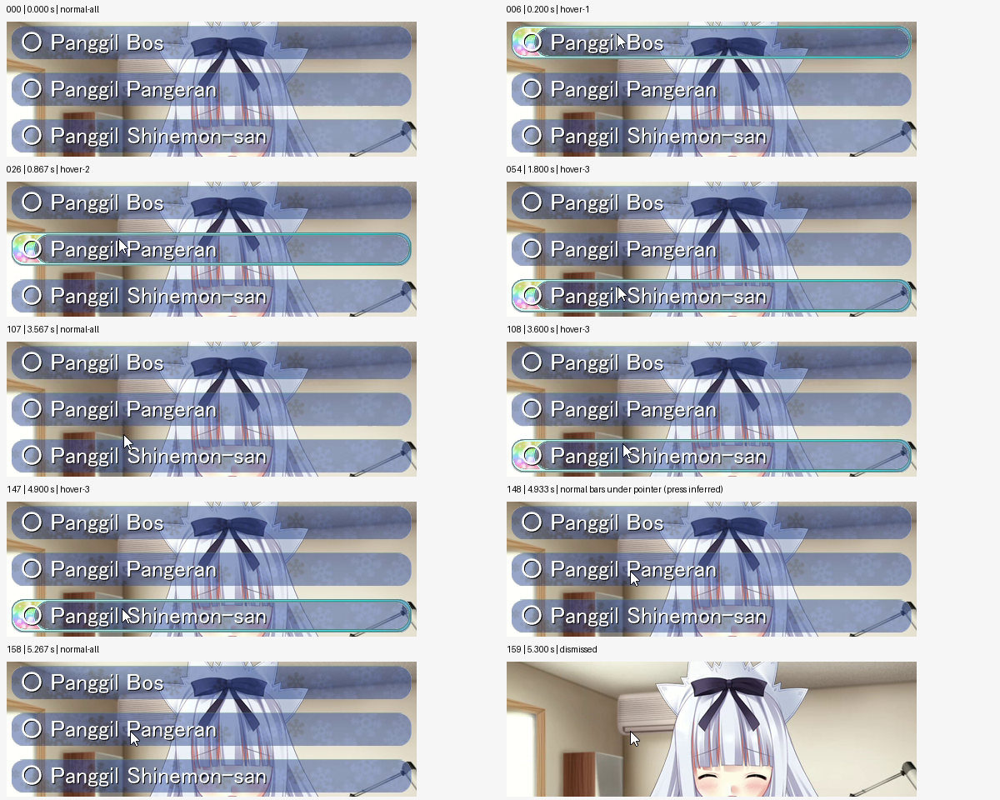
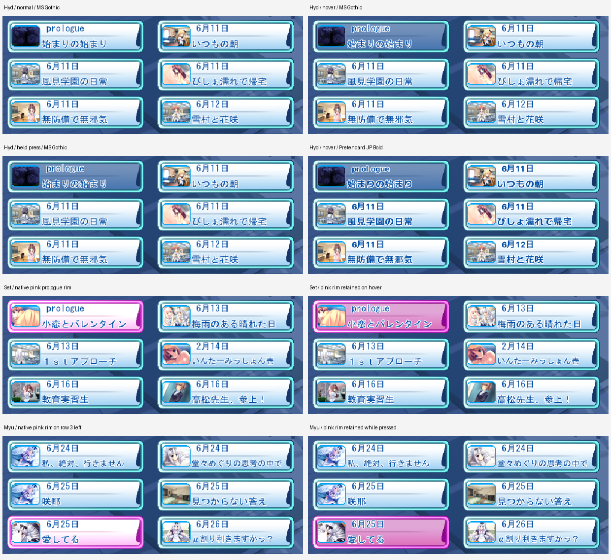
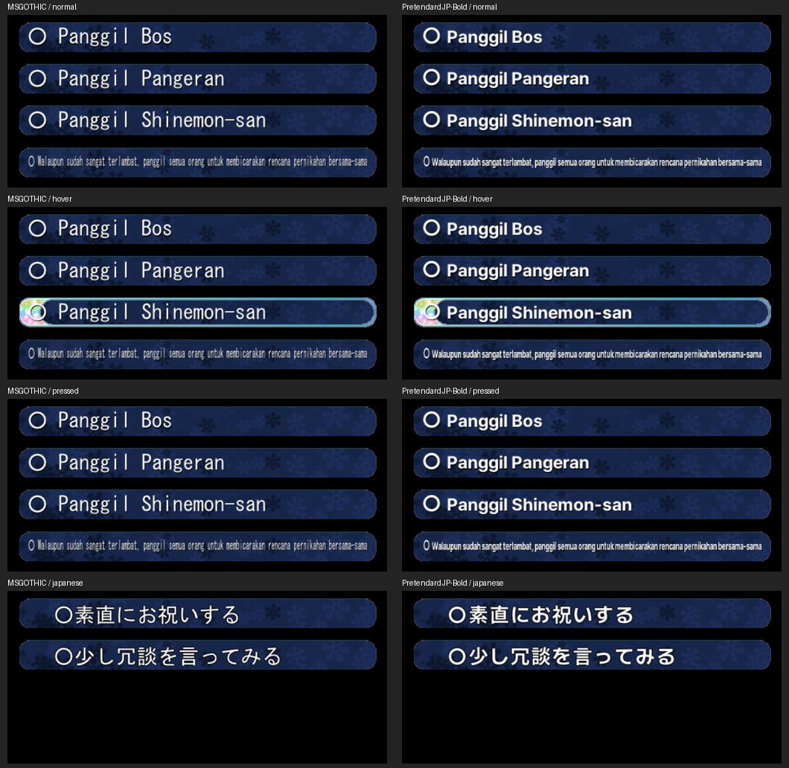

# DC2TY: Scene Replay dan choice

Pemeriksaan ini melanjutkan rekaman PC dan Arisa32 dari chat `adv32roid progress`. Fokusnya adalah tanggal dan bingkai Scene Replay, serta keadaan normal, hover, tekan, dan penutupan choice.

## Acuan visual dan bukti

Tampilan mengikuti aset dan susunan asli DC2TY. ENERGY 2 / RHYTHM 1 / MOTION 2: daftar tetap teratur, aksen menunjukkan interaksi, dan transisi mengikuti bukti game. Font tetap mengikuti pilihan pengguna. Tidak ada artwork baru.

Semua nomor frame di bawah dimulai dari nol. Rekaman 30 fps membatasi ketelitian waktu menjadi sekitar 33,3 ms; waktu mouse-down/up disimpulkan dari tampilan karena tidak ada log input.

### Scene Replay

- Acuan PC: `dc2tysceneuireactpc.mp4`, 519 frame, 794x620. Pembanding Arisa32: `dc2tysceneuireactarisa32.mp4`, 485 frame. Frame penuh dan batas perubahan ditelaah; keluaran sementara berada di Windows Temp.
- Tanggal tetap terlihat saat baris disorot. Bingkai luar aqua bertahan; bingkai merah muda pada prologue Set terlihat sepanjang frame 81..139 dan bukan penanda hover baru.
- Frame 282 beralih dari grup 機械の心 (Myu), halaman 1/3, ke Hyd, halaman 1/5. Itu pergantian grup, bukan perpindahan ke halaman kedua. Tanggal `6月11日` pada baris kedua Hyd tetap tampak di atas panel gelap.
- Pemutaran replay mulai meredup pada frame 299, hitam pada 312..350, kelas muncul pada 351, karakter pada 358, dan dialog pada 361. Bagian menu/konfirmasi setelahnya bukan sasaran perubahan ini.

### Choice

Acuan: `20261110-1043-34.1098260.mp4`, 209 frame, 792x622. Seluruh frame diukur dan enam lembar kontak serta batas perubahan diperiksa.

| Frame | Tampilan |
| --- | --- |
| 0..5 | Tiga choice sudah terlihat, tanpa hover |
| 6..25 / 26..53 / 54..80 | Hover baris 1 / 2 / 3 |
| 81..97 / 98..106 | Hover kembali ke baris 1 / 2 |
| 107 | Cursor berada di celah, tanpa hover |
| 108..147 | Hover baris 3, tetap statis |
| 148..158 | Cursor pada baris 2; panel dan teks bertahan, hiasan hover hilang |
| 159..208 | Semua choice hilang bersama; dialog berlanjut |

Interval 11 frame terakhir sesuai keadaan tombol ditahan. Durasi itu tidak membuktikan adanya animasi atau timer 367 ms. Rekaman dimulai sesudah choice muncul, sehingga animasi masuk tidak dapat ditentukan dari klip ini.

Panel asli berukuran 480x40 pada x136, y100/156/212, jarak antarawal baris 56 px. Rekaman memakai skala 1:1 dengan offset x-4, y+26. Caption yang tampak adalah bahasa Indonesia: `○ Panggil Bos`, `○ Panggil Pangeran`, `○ Panggil Shinemon-san`. Simbol lingkaran merupakan bagian caption; awal seluruh label adalah panel+12, bukan posisi huruf pertama sesudah lingkaran.

## Perubahan

- Scene Replay memakai chip hover asli saat tombol ditahan apabila aset pressed tidak tersedia. Caption header tidak lagi dibatasi pada keadaan normal, sehingga tanggal, prologue, dan epilogue tetap tergambar.
- Bingkai merah muda hanya berlaku untuk `set_0214_f1_214` dan `ty_myu06_f2_myu`, sesuai lookup native pada VA `0x407330`. Renderer PC memakai bagian `sce_chip` y328 untuk normal dan y384 untuk hover. Warna ini merupakan aturan skenario, bukan penanda progress atau pilihan baru.
- Header mengikuti pemetaan native DC2TY, termasuk kilas balik dan penutup tiap rute, dengan tinta biru `(0,77,165)` dan outline putih. Lookup executable berada pada VA `0x407410..0x4094E2`; format header pada `0x409A1B`. Seluruh 129 nama dibandingkan dengan lookup tersebut, tanpa ketidakcocokan. Warna berasal dari `start.mes`, raw66 pada offset 3078. Caption skenario memakai posisi dan ukuran native.
- Parser slot daftar tidak lagi mengonsumsi jump berikutnya sebagai tag tombol. Ini menghilangkan sepuluh baris klik kosong yang sebelumnya muncul pada halaman terakhir yang tidak penuh.
- Choice DC2TY memakai keadaan pressed dari script: isi panel bertahan, bunga dan bingkai hover hilang. Pelepasan pilihan tetap langsung memilih cabang, tanpa penundaan baru.
- Caption Latin berawalan `○` menormalkan spasi dan karakter ASCII fullwidth. Label dimulai pada panel+12, terpusat vertikal, maksimum tinggi tinta 28 px, dengan bayangan satu piksel. Ukuran font dicoba dari 28 hingga 18; teks sangat panjang dipadatkan horizontal jika diperlukan. Font pengguna tetap dipakai.
- Penempatan caption Jepang dan perilaku DC2PC dipertahankan. Jalur Android yang ada meneruskan DOWN/MOVE dan melakukan `choose()` pada UP; perubahan host input tidak diperlukan.

Baris keempat pada gambar hasil renderer adalah fixture teks panjang untuk memeriksa batas panel, bukan dialog dari rekaman. Latar hitam fixture membuat panel transparan tampak lebih gelap daripada panel di atas gambar karakter PC.

## Validasi

Build Android dengan perbaikan keterbacaan berhasil. Pada 10 November 2026, delapan tes akhir lulus: text_render, DC2PC menu, DC2TY menu dan choice, DC2DM menu dan varian Pretendard, confirm_dialog, serta system_menu. Waktu total 109,18 detik; hasil tercatat dalam `regressions-readability-final.log` di direktori Temp `arisa32-dc2ty-scene-react`.

APK tersebut sudah terpasang di HP (versi 0.7.1, code 19; pembaruan 10 November 2026 pukul 20:51:04 Bangkok). Pemeriksaan hanya-baca pada sesi lanjutan memastikan SHA256 APK terpasang sama dengan build lokal: `0A915934727037FC72F1D259582D474016D1797E3122D1AF37A56F75A2E7F1D8`. Kegagalan transfer awal selesai setelah pengiriman tanpa kompresi dan pemasangan paket yang hash-nya sudah cocok.

Perbaikan lanjutan yang termasuk dalam APK ini:

- Scrollbar dengan persegi panjang di luar kanvas asli 800 px ditolak, sehingga bagian thumb yang lebih lebar tidak menyembul di sisi kanan Scene Replay.
- Caption replay dirender langsung pada resolusi keluaran. Judul Latin menormalkan teks fullwidth dan memakai jarak proporsional; judul panjang mengecil dari 16 ke 14 px, lalu memakai elipsis bila masih tidak muat.
- Probe bingkai memeriksa 4.857 piksel rim opak pada masing-masing dari sepuluh baris, termasuk normal, hover, dan tekan; semua cocok dengan artwork sumber. Fragmen tambahan yang terkonfirmasi berasal dari scrollbar.

Verifikasi visual Scene Replay di HP dengan APK keterbacaan ini masih tertunda. Capture menu lama mendahului pemasangan APK tersebut. Pada sesi lanjutan, pengguna meminta akses HP dihentikan saat memakai aplikasi lain; pengujian dilanjutkan melalui desktop dan kode.

## Batas pemeriksaan

- Tidak ada bukti animasi masuk choice di rekaman.
- Tes choice memverifikasi renderer/core dan pemilihan cabang; urutan gesture Android diperiksa dari kode host, belum direkam melalui gesture fisik pada APK baru.
- Perbedaan lebar glyph antara MS Gothic, Pretendard JP Bold, dan font patch PC tetap ada karena font pilihan pengguna dipertahankan.
- Audit antislop dibatasi pada perubahan ini dan reproduksi UI game yang diminta pengguna; ini bukan audit aksesibilitas seluruh aplikasi.
