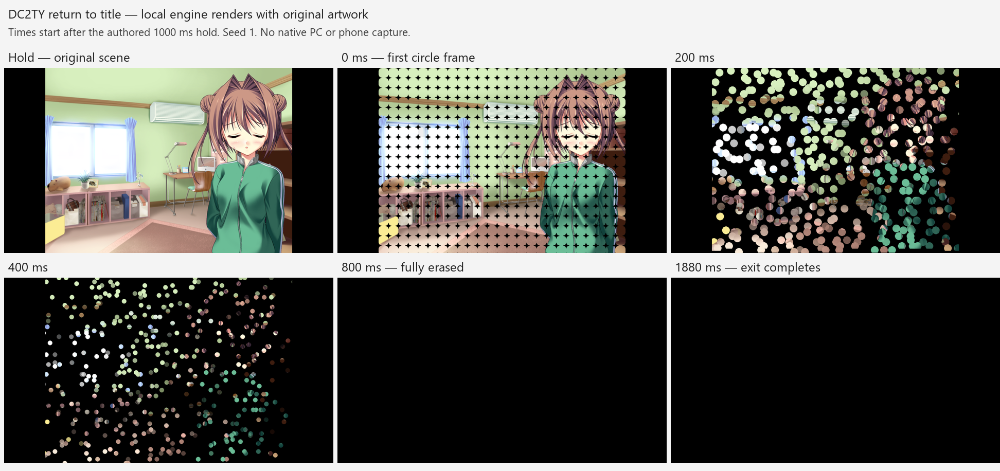

# DC2TY scene transitions

The TY profile now handles raw `0D` modes 13, 14 and 20 separately from DC2PC and DC2DM. Previously it discarded the second operand, ignored modes 13/20, and replaced mode 14 with a fade to black.

The Android and SDL in-game return-to-title handlers also bypassed `advmenu.mes`: Android used a plain fade after a one-second wait, while SDL opened the title immediately. Both now use the same SceneRunner mode `(14,4)` renderer after the authored one-second wait. The host transition holds input and the VM until the outgoing effect finishes, then opens the title intro without adding a second host fade. Its clock advances only with active host time. SDL also resynchronizes TY's speed and breakup settings after configuration changes and restores, and starts the title intro with a fresh clock on the commit frame.

## Native evidence

Analysis used the installed `DC2TY.exe`, SHA256 `21988CA3227D494AD8FD816FD6363670B1A6245F82AC28314C4BB4E8353D19BD`, and all 153 classic TY scripts. Addresses below are executable virtual addresses. Raw `0D` dispatch begins at `0x41ED2E`; its operands are stored at `0xAD64E0` and `0xAD64E4`.

| Mode | Native path | Script evidence |
| --- | --- | --- |
| 13 | Dispatch `0x41EFD4`, mask initializer `0x4260D0`, loop `0x426230`, blend `0x4117D0` | 77 calls: selector 1 appears 29 times, selector 2 appears 48 times. `hyd_b_001_pst.mes` uses white at offset 1009, `(13,2)` at 1019, another background at 1025, and `(13,2)` at 1040. |
| 14 | Dispatch `0x41F00D`, initializer `0x4195B0`, update `0x419BA0`, draw `0x419AE0`, loop `0x419E10` | 61 calls: selector 4 appears 6 times, selector 5 appears 55 times. `advmenu.mes` uses `(14,4)` at offset 2294 before black and transfer to `main`. |
| 20 | Dispatch `0x41F0A7`, callback `0x421018`, blend `0x40FDC0` | 66 calls: speed 2 appears 4 times, speed 3 appears 44 times, speed 5 appears 18 times. `ed_ajs.mes` uses `(20,3)` at offsets 70, 91 and 112. |

Offsets are relative to the script code, including its two-byte version. Bank `99[12]` is the native speed setting at `0x52A3F8`; bank `99[20]` enables screen breakup at `0x52A3FC`. The VM now accepts writes to TY's `99[20]`; the modern read-only table previously discarded this configuration value, forcing every breakup call through its disabled fallback.

## Recovered behavior

Mode 13 starts with alpha `8 - x/4` for selector 1 and `8 - x/4 - y/4` for selector 2, using integer coordinates on the native 800 by 600 canvas. Its first draw uses this field unchanged. Each later 40 ms tick adds the current progress to the field. Progress increments by `1 << bank99[12]` before the addition and is capped at 16 afterward. Each pixel clamps alpha to 0 through 16, then blends the target into the previous displayed pixel with denominator 16. Completion copies the target exactly after the final tick's wait.

| Speed setting | Selector 1 duration | Selector 2 duration |
| --- | --- | --- |
| 0 | 840 ms | 1160 ms |
| 1 | 640 ms | 960 ms |
| 2 | 520 ms | 800 ms |
| 3 | 400 ms | 680 ms |

Mode 20 uses a frozen source and target with `(source * (256-alpha) + target * alpha) >> 8`. It increments alpha before drawing. Explicit parameters 1 through 7 use increments 128, 64, 32, 16, 8, 4 and 2 every 40 ms. Parameter 0 uses increments 16, 32, 64 or 128 from the speed setting. Parameters at least 8 use increment 2 and interval `(parameter - 7) * 40 ms`. The exact target appears one interval before callback cleanup; parameter 3 resumes after 320 ms and parameter 5 after 1280 ms. This is a full-frame dissolve. DC2DM mode 20 retains its separate authored-mask behavior.

Mode 14 uses 25 columns by 19 rows of 32-pixel tiles. The bottom row contains 24 source pixels. `GRP/system/eff.CRX` contains 25 mask frames in an 800 by 32 sheet, using only black and magenta. Native `0x40E6E0` writes only the magenta color key into the captured screen, so transparency accumulates permanently. The atlas frame uses each tile's updated age. Frames 20 through 24 erase the entire tile. Tiles draw in row order over black using `(destination * (16-opacity) + source * opacity) >> 4`.

Selectors 4 and 5 use the recovered velocity distributions, delay fields, fixed-point arithmetic and CRT random call order. Selector 5 delays a tile by `column + 2*row`. Each active update advances time by 81 in 1024-based fixed point. It uses the native quadratic term with coefficient 4008 and truncation toward zero. Rendering occurs before the 40 ms wait, including the final black frame. Cleanup hides native character slots 1 through 5. With initial CRT seed 1, selectors 4 and 5 finish after 47 and 106 updates respectively, or 1880 and 4240 ms.

The engine keeps the native canvas centered in its 960 by 720 classic viewport. The circle renderer samples the displayed frame into an 800 by 600 source, performs tile composition there, then scales it into that viewport. Breakup falls back to mode 2 when bank `99[20]` is zero or its sheet is unavailable. Other mode 14 selectors retain the existing fallback; the installed TY scripts only use 4 and 5.

## Validation and remaining comparison

`dc2ty_transition_test` exercises authored-style white cover/reveal pairs, both directional masks at all four speed settings, cumulative first-frame blending, dissolve speed operands, native grid clipping, delayed tiles, batched updates, exact black/target endpoints, final wait intervals, skip, disabling effects, save restore, and DC2PC isolation. Its synthetic atlas intentionally returns to black after frame 1 to check that erased pixels stay transparent.

The host-stage case checks the one-second hold, exact 1880 ms circle duration after that hold, paused draws, a single black commit boundary, and a stationary VM while a sidebar is open. Android and SDL call this same tested presentation/SceneRunner API pair.

Android marks an accepted TY title exit until its commit. If lifecycle pause occurs during the hold or circle animation, it removes the old lifecycle checkpoint through the title path instead of trying to serialize an active script wait. Manual save behavior is unchanged. This Android lifecycle branch has source review and successful JNI compilation; no runtime JNI pause test was performed because the available probe requires a device.

The desktop Release build succeeded for `arisa32_desktop`, `dc2ty_transition_test`, `dc2pc_menu_transition_test`, and `mesvm_test`. Targeted CTest execution passed all three test targets in 11.90 seconds. The combined regression run also passed `dc4_sprite_motion_test`, `dc2dm_transition_test`, `dc2pc_flow_test`, and `dc2dm_sprite_test` (4/4).

The final Android `assembleDebug` rebuild passed in 3 minutes 7 seconds for `arm64-v8a` and `armeabi-v7a`, including the pending-title pause fix and the later [date-change eyecatch fix](dc2ty-eyecatch-fix.md). The output is `android/app/build/outputs/apk/debug/app-debug.apk`, version 0.7.1, version code 19, 19,533,320 bytes, written on 2026-11-10 at 22:21:59 Bangkok time. `apksigner verify --verbose` passed v1 and v2 signature checks. APK SHA256: `D1410421216C3AA7D883F23D3ABF51804C8CC4E944ABC9CAA5E734B49D1DA38A`. Following the user's explicit installation request, `adb install -r` succeeded on the connected I2219 phone; package metadata confirmed version 0.7.1/code 19 and update time 2026-11-10 22:31:17 Bangkok time. The app was not launched and no screen capture was taken; device visual verification remains pending.

An additional run passed the full transition suite and the original-asset probe with zero failures. The probe loads `hyd_0611_a2_com.mes` at dialogue marker 85, enables `99[20]`, and captures the supplied-frame title-exit renderer at 0, 200, 400, 800 and 1880 ms. It loads the installed game's actual `eff.CRX`, checks that the VM remains at the same dialogue, and confirms that completion occurs at 1880 ms. The original mask sheet has erased all visible pixels by 800 ms; the remaining tile lifetimes keep the transition waiting on black until cleanup.

Source: offline renders produced by this engine from the installed DC2TY artwork, composed and visually inspected locally. Times in the figure are elapsed effect time after the entry wait. The original-asset probe calls the SceneRunner renderer directly; the separate host-stage test checks the one-second wait, pause-stable draws, VM immobility and single black commit. These captures do not exercise the Android or SDL UI paths, run the original executable, or record a device.

This implementation follows static executable and asset evidence. No matching PC/Android video comparison has been performed for these changes. The CRT algorithm and call order match, but the engine's random stream starts from seed 1 and does not reproduce the original process's session seed or unrelated random calls. Pixel identity after the engine's existing viewport scaling also needs visual comparison.

The visual direction remains the original game's masks and timing. No new presentation assets or controls were added.
