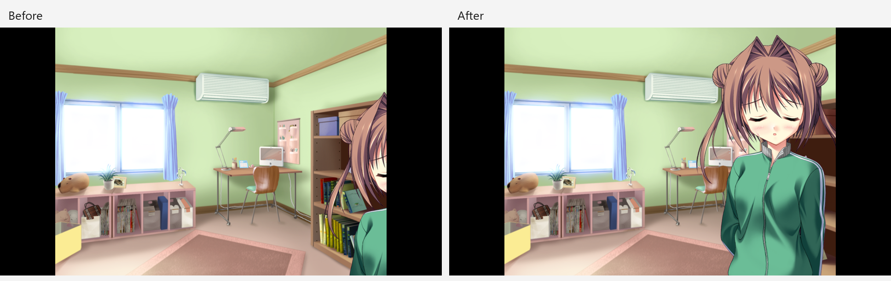

# DC2TY close-up sprite placement

The reported Yume tracksuit close-up is in `hyd_0611_a2_com.mes`, checkpoint 85. The script sets origin `(210, 0)`, scale `100%`, anchor `(441, 322)`, then loads `bst\yme_1d_013_b`. The installed loose CRX is 1260 × 1080 with zero crop offset and compression 2. The original Japanese dialogue is `「ん……んん……」`.

## Cause and native reference

`CrxInfo.canvas_width` and `canvas_height` are populated from compression 3 registration records. This compression 2 asset has no registration record, so both fields were zero. `SceneRunner::load_bst` copied these zeros into the sprite, disabling the existing classic DC2 close-up anchor correction. The same dimensions also decide whether raw `0x2C` selects the `_b` expression patch.

A header scan of the installed `GRP/BST` directory found 1,246 CRXG files: 768 at 882 × 756, 477 at 1260 × 1080, and one at 800 × 600. All use compression 2; every large sprite has zero crop offsets. The fallback therefore restores the common close-up format while standard dimensions stay below the native correction thresholds.

The installed `DC2TY.exe` (SHA-256 `21988ca3227d494ad8fd816fd6363670b1a6245f82ac28314c4bb4e8353d19bd`) uses actual bitmap dimensions:

- `0x402370` allocates image rows from width and height arguments. `0x402423` stores the width in the handle table at `0xA22C94 + handle * 0x80`; `0x40242F` stores the height at `0xA22C98 + handle * 0x80`.
- `0x41BFFD–0x41C096` reads these dimensions and applies close-up correction when width exceeds 882 or height exceeds 756. `0x41D112–0x41D1B7` repeats the calculation for sprite bounds.
- `0x41D743` and `0x41D753` use the same dimensions to choose a close-up expression when both thresholds are exceeded.

For checkpoint 85, the native integer operations give:

```text
X correction = 441 - ((1260 * 100 / 882) * 441 / 100) = -185
Y correction = 322 - ((1080 * 100 / 756) * 322 / 100) = -135
```

The bitmap origin therefore changes from `(210, 0)` to `(25, -135)` in the native 800 × 600 viewport. In Arisa32's 1280 × 720 frame, the bitmap origin changes from `(412, 0)` to `(190, -162)` after the existing 1.2 scale and 160-pixel side margin. This moves the character 222 pixels left and 162 pixels up without changing its size.

## Fix boundary

Classic DC2 sprite loads use the decoded bitmap width or height when the corresponding explicit registration dimension is absent. This fallback is applied only after calculating the cropped image's frame centre. Treating the fallback as a compression 3 registration frame would incorrectly introduce another 118-pixel horizontal offset for a 1260-pixel loose asset.

The correction is shared by DC2TY and DC2PC through their existing classic DC2 path. Explicit registration records keep their previous placement. DC2DM and modern games retain their existing metadata and pivot rules. Save restoration reloads the sprite through the same path, so no save-format migration is required.

## Regression fixture

`dc2ty_sprite_test` writes sparse compression 2 assets to a temporary directory. It checks visible pixels for the native checkpoint-85 origin and anchor, `_b` expression selection, removing an expression, cached body reuse, 75% scaling, returning to standard dimensions, and save restoration. The fixture runs with both DC2TY (`0x5F69`) and DC2PC (`0x9969`) script profiles. A compression 3 fixture protects the existing explicit registration behavior.

With installed DC2TY data, the test advances the original script to checkpoint 85, checks the exact asset and transform, renders it, and compares a fresh save restoration with the rendered frame. Temporary PPM captures can be produced with:

```powershell
cmake --build build/desktop --target dc2ty_sprite_test
build/desktop/dc2ty_sprite_test.exe E:/Games/DC2TY/AdvData "$env:TEMP/arisa32-dc2ty-sprites/after"
```

`--capture-only` before the data path skips synthetic placement assertions, allowing the unchanged renderer to produce a before capture with the same original script and assets.

## Verification on 2026-11-10

The shared desktop build compiled the new target before and after the sprite change. The baseline produced 14 expected failures, covering missing dimensions, incorrect close-up pixels, and the wrong expression variant in both classic profiles. Reduced-scale placement, standard sprite pixels, and explicit registration already passed. With the fallback applied, the synthetic cases and original checkpoint-85 case completed with **0 failures**. Restoring the saved original scene reproduced its frame exactly.

Both images below come from `SceneRunner` running the installed original script and assets, with the message window hidden for placement review. The before image reproduces the character clipped at the right edge. The after image shows her face and upper body at the native-corrected position. These are PC test renders, not a new device capture or a screenshot of the original native executable.



## Delivery gate

- Hard gate PASS: the exact scene was built, run, and visually checked; the comparison uses original game assets and identifies its source. No controls, navigation, copy, or new artwork were added.
- Purpose gate PASS: the only visual change restores the native bitmap-dimension correction, with the integer calculations and executable addresses recorded above.
- Liveliness PASS: the original composition, palette, artwork, and character pose are preserved; the character's face is now visible in the existing focal position. No new visual direction or animation was introduced.
- Craftsmanship PASS: native dimensions were checked against all 1,246 installed BST headers; targeted pixel, expression, scale, cache, explicit-registration, and save-restore checks pass. The code adds one factual comment explaining the loose-CRX fallback.
